# BRANDTRACE AI — PHASE 2: FIVE-ROLE WORKFLOW CONNECTIVITY REPORT

**Document ID**: BT-REPORT-PHASE2-2026-11-16  
**Status**: COMPLETE & VERIFIED  
**Target Environment**: FastAPI + MongoDB Atlas + React Vite TypeScript  
**Regression Test Status**: 201/201 Tests Passed (100%)  
**Frontend Production Build**: Zero Errors (`tsc && vite build` in 8.09s)

---

## 1. Executive Summary

Phase 2 implementation has unified and strictly enforced the end-to-end brand governance lifecycle across all five BrandTrace AI roles:
1. **Creator** (`asha@aurelle.com` / `CREATOR`)
2. **Agency** (`sana@aurelle.com` / `AGENCY` / `ORG-AGENCY-PULSE`)
3. **Reviewer** (`meera@aurelle.com` / `REVIEWER`)
4. **Compliance Reviewer** (`arjun@aurelle.com` / `COMPLIANCE_REVIEWER`)
5. **Brand Owner** (`kabir@aurelle.com` / `BRAND_MANAGER`)

All status transitions, version snapshots, finding-by-finding decisions, and cryptographic proofs persist in MongoDB Atlas with in-memory fallback. Role-based access control (RBAC) is enforced at the backend API layer to strictly prevent unauthorized actions and workflow skipping.

---

## 2. End-to-End Five-Role Lifecycle Architecture

```mermaid
flowchart TD
    subgraph Step1["Step 1: Creator Workspace"]
        A[Creator drafts marketing copy] --> B[AI content analysis & findings check]
        B --> C[Creator applies corrections]
        C --> D["POST /api/submissions (Status: PENDING_REVIEW)"]
    end

    subgraph Step2["Step 2: Agency Workspace"]
        D --> E["GET /api/submissions/queue?role=agency"]
        E --> F[Agency inspects brand voice & guidelines]
        F --> G["POST /api/submissions/{id}/agency-review (FORWARD / REQUEST_CHANGES)"]
    end

    subgraph Step3["Step 3: Reviewer Workspace"]
        G --> H["GET /api/submissions/queue?role=reviewer"]
        H --> I[Reviewer inspects original vs revised content]
        I --> J[Reviewer upholds/overrules findings]
        J --> K["POST /api/submissions/{id}/review (Status: REVIEW_APPROVED)"]
    end

    subgraph Step4["Step 4: Compliance Workspace"]
        K --> L["GET /api/submissions/queue?role=compliance"]
        L --> M[Validates FACT-014 clinical evidence & statutory pricing]
        M --> N["POST /api/submissions/{id}/compliance (Status: COMPLIANCE_APPROVED)"]
        N --> O["Generates Cryptographic Seal BT-SEAL-XXXXXX"]
    end

    subgraph Step5["Step 5: Brand Owner Workspace"]
        O --> P["GET /api/submissions/queue?role=brand-owner"]
        P --> Q[Verifies mandatory prior approvals: Reviewer + Compliance]
        Q --> R["POST /api/submissions/{id}/final-approval"]
        R --> S["Generates Release ID BT-REL-2026-XXXXXX & SHA-256 Digest"]
        S --> T["Status: RELEASED"]
    end

    subgraph Step6["Public Verification Gate"]
        T --> U["GET /api/public/verify/{release_id}"]
        U --> V["Status: APPROVED | Ledger: VALID_UNCHANGED | Authentic: true"]
    end
```



---

## 3. Targeted Fixes & Enhancements Implemented

### 3.1 Backend Service & Engine Fixes
1. **`backend/brandtrace/database/mongo.py`**:
   - Added backward-compatible alias `save_revision_task = save_task` ensuring consistent revision task synchronisation.
2. **`backend/brandtrace/modules/submissions/service.py`**:
   - **Custom & Generated Submission ID Preservation**: Honors caller-provided IDs while falling back to `SUB-XXXXXX`.
   - **`record_agency_decision`**: Added explicit agency workflow lifecycle management. Agency can forward approved client drafts (`AGENCY_APPROVAL` step `COMPLETED`) or return to creator for revisions (`RETURNED_TO_CREATOR`).
   - **Role Queue Filtering**: Added explicit `role == "agency"` query filtering in `list_submissions` allowing Agency users to monitor client drafts, submissions from `ORG-AGENCY-PULSE`, and assigned tasks.
   - **Compliance Ledger Recording Call**: Corrected keyword arguments in `audit_ledger_engine.record_release` to accept `user_identity`, `user_role`, `resource_id`, `resource_type`, `content`, `decision`, `review_notes`, and `approved_version`.
3. **`backend/brandtrace/modules/submissions/models.py` & `router.py`**:
   - Created `AgencyDecisionRequest` model.
   - Exposed `POST /api/submissions/{submission_id}/agency-review`.
   - Hardened RBAC: Standard Creators cannot record review or compliance decisions; Reviewers and Compliance officers cannot bypass workflow to grant final brand release.
   - Enforced workflow gate validation: Brand Owner cannot release an asset unless prior Reviewer and Compliance approvals are both `COMPLETED`.

### 3.2 Frontend Role Workspace Fixes
1. **`frontend/src/components/creator/RoleDashboardStage.tsx`**:
   - Enabled `CLIENT REVIEW` queue tab for Agency role.
   - Wired queue API to `/api/submissions/queue?role=agency`.
   - Added agency decision routing to call `/api/submissions/${id}/agency-review`.
2. **`frontend/src/components/creator/ReviewDetailView.tsx`**:
   - Added dedicated Agency decision action buttons:
     - `Return to Creator` (`REQUEST_CHANGES`)
     - `Reject` (`REJECT`)
     - `Forward to Reviewer` (`APPROVE`)

---

## 4. Test Execution & Verification

### 4.1 Automated End-to-End Workflow Test (`test_phase2_five_role_workflow.py`)
- **Step 1 (Creator)**: Creator creates draft $\to$ submits copy $\to$ verified `status == PENDING_REVIEW`, `version == 1`, unique `SUB-XXXXXX` generated.
- **Step 2 (Agency)**: Agency monitors queue $\to$ executes agency review $\to$ verified `AGENCY_APPROVAL` marked `COMPLETED`.
- **Step 3 (Reviewer)**: Reviewer inspects findings $\to$ upholds `FACT-014` and `FACT-006` $\to$ verified `status == REVIEW_APPROVED`.
- **Step 4 (Compliance)**: Compliance validates statutory/clinical evidence $\to$ verified `status == COMPLIANCE_APPROVED` with `BT-SEAL-XXXXXX` release seal.
- **Step 5 (Brand Owner)**: Verifies prior stages $\to$ grants release $\to$ verified `release_id` (`BT-REL-2026-XXXXXX`) and 64-char SHA-256 digest generated (`status == RELEASED`).
- **Step 6 (Public Verification)**: `GET /api/public/verify/{release_id}` returns `is_authentic == true`, `status == APPROVED`, `ledger_state == VALID_UNCHANGED`.
- **Step 7 (RBAC & Negative Tests)**:
  - Creator attempting review decision $\to$ HTTP 403 Forbidden.
  - Creator attempting compliance sign-off $\to$ HTTP 403 Forbidden.
  - Reviewer attempting final brand release $\to$ HTTP 403 Forbidden.
  - Brand Owner attempting release on unapproved draft $\to$ HTTP 400 Bad Request ("submission must first successfully complete Reviewer approval and Compliance approval").

### 4.2 Full Regression Suite
```
pytest backend/tests
201 passed in 7.28s (100% PASS RATE)
```

### 4.3 Frontend Production Build
```
tsc && vite build
✓ 2546 modules transformed.
✓ built in 8.09s (0 TypeScript errors)
```

---

## 5. Next Steps

Phase 2 Five-Role Workflow Connectivity is fully verified, operational, and tested. In accordance with Master Implementation Rule 12, no commits or deployments to production remotes have been pushed without your explicit approval.
