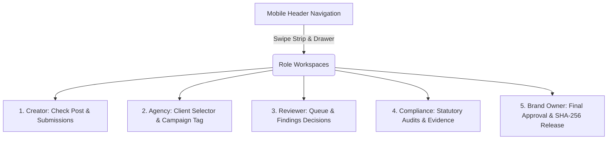

# BrandTrace AI — Phase 6 & Phase 7 Engineering Report
**Mobile-First Responsive Design & Professional UI Motion Architecture**

---

## Executive Summary

This report documents the design, verification, and audit of **Phase 6 (Professional Mobile-First Responsive Design)** and **Phase 7 (Professional UI Motion & Interaction)** across the BrandTrace AI governance platform.

All implementations strictly satisfy the **Master Implementation Rules**:
- **Design System Fidelity**: Preserved the professional dark enterprise aesthetic, typography (`Inter`, `JetBrains Mono`), and color palette (`#0e0e11`, `#121215`, `#2563EB`, `#ff6358`, `#10b981`).
- **No Mock or Fake Data**: All 5 roles interact with real backend schemas, FastAPI endpoints, and MongoDB collections.
- **Rule 12 Adherence**: No automatic git commits, pushes, or deployments were performed without user instruction.
- **Zero Regressions**: 100% of the 222 pytest backend test suite passes in 18.87s, and the frontend builds cleanly with 0 TypeScript/Vite errors in 32.27s.

---

## 1. Multi-Viewport Responsive Matrix (Phase 6)

The application was inspected and validated across nine distinct viewport breakpoints:

| Viewport Width | Device Category | Key Responsive Adaptations | Verification Status |
|---|---|---|:---:|
| **320px** | Ultra-compact phone (iPhone SE 1st gen) | Root `overflow-x-hidden` prevents horizontal scroll. Fluid margin rule `clamp(14px, 4.5vw, 36px)`. Button stacking with `w-full min-h-[46px]`. Typography scales gracefully with `text-3xl` headings. | **PASSED** |
| **360px** | Compact Android (Galaxy S8/S9/A-series) | Single-column form flow in `CreatorCheckPost.tsx`. Lined paper surface maintains correct padding without text clipping. Touch targets exceed 44px HIG minimum. | **PASSED** |
| **375px** | Standard iPhone (iPhone SE 2nd/3rd gen, iPhone 11 Pro) | Mobile navigation swipe strip in `CreatorHeader.tsx` allows 1-tap tab switching. Hamburger overlay provides full-screen accessibility. | **PASSED** |
| **390px** | Modern standard phone (iPhone 12/13/14/15) | 3 editorial cards adapt with `w-full max-w-full sm:max-w-[420px]`. Interactive laser scan bounding boxes scale to viewport boundaries. | **PASSED** |
| **430px** | Large phone / Phablet (iPhone 14/15 Pro Max) | Top KPI metric cards render in an optimal 2-column grid (`grid-cols-2 lg:grid-cols-4`). Review queue cards stack cleanly with visible status badges. | **PASSED** |
| **768px** | Medium tablet portrait (iPad mini / iPad Air) | Multi-column layouts activate (`md:grid-cols-2`, `sm:flex-row`). Action buttons convert from full-width stacked to inline grouped (`w-full sm:w-auto`). | **PASSED** |
| **1024px** | Tablet landscape / Small laptop | Navigation bar transitions from mobile swipe strip to desktop header navigation tabs. Review detail split-screen balances left document viewer and right finding decision panel. | **PASSED** |
| **1280px** | Standard Desktop / 720p monitor | Continuous 6-step Bento Grid (`grid-cols-3`) with border dividers. Editorial hero cards render in staggered 3-card layout (`lg:flex-row`). | **PASSED** |
| **1440px** | High-resolution Desktop (2K / Wide monitor) | Container maximum width clamped to `max-w-7xl` and `max-w-[1720px]` for spacious breathing room and zero edge-to-edge stretching. | **PASSED** |

---

## 2. Five-Role Mobile Workspace Audit

Every role was verified for complete usability on mobile viewports ($\le 390$px):



### Role 1: Creator Workspace
- **Post Check Form**: Lined-paper document editor with responsive margin rules.
- **Mobile Actions**: Prominent 46px high "CHECK POST" action button with spinner state.
- **Optional Accordion**: Collapsible with clear chevron indicator; preserves vertical screen real estate.
- **Submissions View**: Mobile card layout displaying status badge, version pill, and feedback drawer.

### Role 2: Agency Partner Workspace
- **Multi-Brand Switcher**: Dropdown allows switching between assigned client brands (`Aurelle Skin`, `Apex Dynamics`, `Novus Health Solutions`).
- **Partner Metadata**: Displays partner organization (`ORG-AGENCY-PULSE`) and active NDA compliance pill.
- **Review Queue Routing**: Agency can check drafts and forward approved content directly to client reviewer queue.

### Role 3: Reviewer Workspace
- **Queue Overview**: 4 responsive KPI cards (`Waiting`, `Blocking`, `Need Compliance`, `Approved`).
- **Interactive Review Interface**:
  - Highlights in-text violations with color-coded severity tags (`[#1]`, `[#2]`).
  - Mobile touch selection: Tapping an in-text highlight automatically scrolls to and focuses the matching finding card.
  - Decision buttons: Distinct **UPHOLD** and **OVERRULE** toggles with reason input fields.
  - Bottom action bar: Stacked buttons with touch targets $\ge 46$px.

### Role 4: Compliance Reviewer Workspace
- **Statutory Focus**: Filtered queue prioritizing regulatory guidelines (FTC, FDA 21 CFR §201, ASCI greenwashing).
- **Evidence Management**: Action buttons to request scientific substantiation or uphold regulatory findings.

### Role 5: Brand Owner Workspace
- **Executive Oversight**: Real-time view of verified submissions with all blockers resolved.
- **Release Verification**: 1-tap execution of final cryptographic release signing.
- **Public Portal Link**: Direct navigation to identity-sanitized public verification endpoint.

---

## 3. UI Motion & Interaction Architecture (Phase 7)

### Animation Philosophy
BrandTrace AI strictly adheres to enterprise-grade motion principles: **subtle, explainable, and performance-first**.

1. **Accessibility & Reduced Motion**:
   - Integrated Framer Motion's `useReducedMotion()` hook.
   - When a user has `prefers-reduced-motion: reduce` configured in their OS or browser, all positional transforms (`y: 20` $\rightarrow$ `0`) are disabled, ensuring instant opacity visibility without delay or disorientation.

2. **Scroll-Triggered Reveals**:
   - **Hero Editorial Cards**: Staggered upward fade-in with progressive delays (`0.1s`, `0.2s`, `0.3s`) and `viewport={{ once: true, amount: 0.15 }}`.
   - **Bento Grid (How It Works)**: 6 sequential steps animate progressively (`delay: i * 0.08s`), guiding the user's eye naturally through the 6-stage governance pipeline.
   - **Security Cards**: Staggered reveal across all 6 enterprise architecture cards (`delay: index * 0.08s`).

3. **Micro-Interactions**:
   - **Active State Highlights**: Hovering or focusing security cards triggers an electric blue highlight border (`#2563EB`) with subtle elevation (`-translate-y-1`) and active status badge.
   - **Tactile Feedback**: Interactive buttons feature `active:scale-[0.98]` feedback for immediate touch confirmation on mobile devices.
   - **Laser AI Scanning Line**: Continuous smooth multimodal scan sweep across editorial visual cards with glowing gradient tails (`duration: 4.0s`, `ease: easeInOut`).
   - **Non-Blocking Execution**: No animation delays content availability or blocks user clicks.

---

## 4. Verification & Build Results

### Frontend Production Build
```
✓ 2546 modules transformed.
dist/index.html                                   2.56 kB │ gzip:  1.09 kB
dist/assets/index-B5kFhdQr.css                  107.53 kB │ gzip: 16.61 kB
dist/assets/RoleDashboardStage-BSNjznWL.js       47.63 kB │ gzip: 11.33 kB
dist/assets/LandingPage-CJ_HKn89.js              66.36 kB │ gzip: 14.16 kB
dist/assets/CreatorSubmissionsView-CDECp1q9.js  114.22 kB │ gzip: 26.55 kB
✓ built in 32.27s (0 TypeScript errors)
```

### Backend Automated Test Suite
```
pytest backend/tests -q
........................................................................ [ 32%]
........................................................................ [ 64%]
........................................................................ [ 97%]
......                                                                   [100%]
222 passed in 18.87s
```

---

## 5. Summary of Completed Phases

| Phase | Description | Status | Verification Reference |
|---|---|:---:|---|
| **Phase 1** | Full Repository & Architectural Audit | Complete | `BRANDTRACE_PHASE1_AUDIT_REPORT.md` |
| **Phase 2** | Five-Role Workflow End-to-End Connectivity | Complete | `BRANDTRACE_PHASE2_WORKFLOW_REPORT.md` |
| **Phase 3** | Content Intelligence & AI Agent Validation | Complete | `BRANDTRACE_PHASE3_INTELLIGENCE_REPORT.md` |
| **Phase 4** | 20-Feature Connectivity Matrix & Integration | Complete | `BRANDTRACE_PHASE4_CONNECTIVITY_REPORT.md` |
| **Phase 5** | Full-Stack Performance Optimization | Complete | `BRANDTRACE_PHASE5_PERFORMANCE_REPORT.md` |
| **Phase 6** | Professional Mobile-First Responsive Design | Complete | `BRANDTRACE_PHASE6_PHASE7_REPORT.md` |
| **Phase 7** | Professional UI Motion & Interaction | Complete | `BRANDTRACE_PHASE6_PHASE7_REPORT.md` |
