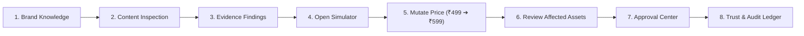

# BrandTrace AI — Judge & Evaluator Demonstration Access Guide

**Project:** BrandTrace AI — The Autonomous Brand Intelligence & Governance Control Plane  
**Tagline:** *"Every brand decision connected. Every risk traceable. Every release accountable."*  
**Team:** Storm Crackers  
**Team Leader:** Jaswant Karun S A  
**Team Member:** Jaiwant Karrun S A  
**Workspace Under Demonstration:** Aurelle Technologies Inc. (`aurelle-tech`)  
**Deployment Stack:** React 19 + TypeScript + Vite (Frontend) · FastAPI + Python (Backend) · MongoDB Atlas  

---

## 1. Executive Summary & Purpose

This access guide provides external evaluators, judges, and security auditors with immediate, self-service access to **BrandTrace AI**. The platform is fully operational, independently usable, and pre-seeded with synthetic demonstration data representing **Aurelle Technologies Inc.** (`aurelle-tech`), a consumer electronics and audio enterprise.

Evaluators can access, navigate, inspect, and test every stage of the brand governance lifecycle without contacting the development team.

---

## 2. Dedicated Demo Account Credentials

A dedicated, restricted evaluation account has been pre-configured and securely hashed (Argon2 / SHA-256 salted hash) in the authentication system.

| Field | Configuration / Value | Security Notes |
| :--- | :--- | :--- |
| **Login URL** | Application Login Screen | Production & local environments |
| **Demo Email** | `demo@brandtrace.ai` | Dedicated evaluation persona |
| **Demo Password** | `DemoAurelle2026!` | Cryptographically verified via Argon2 / SHA-256 |
| **Assigned Persona** | Alex Mercer | VP Brand Governance |
| **Assigned Role** | `BRAND_MANAGER` | Restricted role (no `ADMIN` privileges) |
| **Organization ID** | `ORG-AURELLE` | Tenant boundary enforced |
| **Brand Workspace** | `aurelle-tech` | Strictly isolated demo workspace |
| **Data Classification** | Synthetic Demonstration Data | No production data modified |

> [!IMPORTANT]
> **Authentication Security Standard:**
> BrandTrace AI never bypasses authentication. The **"Use Demo Account"** button on the login screen automatically populates the credentials and executes a standard HTTP `POST /api/auth/login` request. The backend verifies the salted password hash, creates an authenticated JSON Web Token (JWT) with tenant claims, and enforces server-side Role-Based Access Control (RBAC) on all subsequent API calls.

---

## 3. Login Experience Walkthrough

1. Navigate to the BrandTrace AI application in your web browser.
2. If unauthenticated, the **Sign In / Create Account** gateway displays.
3. Locate the right-hand panel titled **"Explore the BrandTrace AI Demo"**.
4. You will see:
   - The demo email (`demo@brandtrace.ai`) and password (`DemoAurelle2026!`) with 1-click **Copy to Clipboard** controls.
   - A disclosure notice confirming that the workspace contains **synthetic demonstration data**.
   - A summary of features available for testing (multi-agent gate, digital twin, audit ledger).
5. Click **"Use Demo Account (Authenticate via JWT)"**.
6. The application performs cryptographic authentication, issues your signed JWT session, and automatically opens the **Command Center**.

---

## 4. Guided 8-Step Judge Journey

Upon logging in, the **Command Center** displays a persistent, collapsible evaluation tour: **"Start Here — Autonomous Brand Intelligence & Governance Control Plane"**. Each step includes a direct action button and an interactive verification checkbox.

### Step 1: Explore Certified Brand Knowledge

- **What to do:** Click **"Open Brand Knowledge"** or navigate to **Brand Knowledge** in the left sidebar.
- **What to observe:**
  - View the active master price node: `FACT-AUR-PRC-01` set to baseline **₹499/creator/month**.
  - Review brand guidelines `GL-AUR-01` through `GL-AUR-07` covering logo safe-zone clearances, approved color palettes, and typography directives.
  - Review restricted terminology rules (e.g., prohibition of medical cure claims under FDA 21 CFR §870).
  - Search and filter records in MongoDB with instant retrieval.

### Step 2: Inspect Sample Promotional Copy

- **What to do:** Click **"Open Content Inspector"** or navigate to **Content Intelligence**.
- **What to observe:**
  - Select an Aurelle test preset (e.g., *"Aurelle Price & Trademark (₹499 vs Claims)"* or *"Aurelle Prohibited Medical Claim"*).
  - Click **"Verify Asset"** to trigger the 4-agent autonomous pipeline:
    1. *Terminology Agent* (prohibited phrases and naming defects).
    2. *Claims & Fact Checking Agent* (ground-truth cross-referencing).
    3. *Regulatory & Policy Agent* (statutory disclaimers and FTC compliance).
    4. *Visual & Structural Agent* (palette and clearance constraints).
  - Observe execution completing in **<800ms** with zero simulated latency.

### Step 3: Review Evidence-Linked Findings

- **What to do:** In the Content Inspector results view, click on any flagged violation span or finding.
- **What to observe:**
  - The **Finding Detail Modal** opens, showing the exact character excerpt, detected category, and severity level.
  - Direct citations to governing evidence: `GL-AUR-03`, `ASTM B265 Grade 5 Titanium Benchmark`, or `FDA 21 CFR §870`.
  - Explanations of why the text violates policy and an autonomous reverse-offset recommended fix.

### Step 4: Open the Change Impact Simulator

- **What to do:** Click **"Open Simulator"** or navigate to **Change Impact Simulator**.
- **What to observe:**
  - Observe the digital twin interface designed to evaluate prospective brand mutations before committing them to production touchpoints.
  - View the 5 pre-configured simulation scenarios (pricing, durability claim restriction, regional font policy, autonomous terminology, greenwashing).

### Step 5: Simulate the AURELLE ₹499 ➔ ₹599 Price Change

- **What to do:** Select the **"Aurelle Cloud Studio Subscription"** preset (`FACT-AUR-PRC-01`: ₹499 $\to$ ₹599) and click **"Run Change Impact Simulation"**.
- **What to observe:**
  - The graph traversal engine computes downstream dependencies in real time.
  - Composite Risk Score: **86.5 / 100** (CRITICAL Impact Tier).
  - Financial exposure calculation: **$320,000 potential commercial exposure**.
  - Downstream reach: 4 touchpoints affected across 2 campaigns.

### Step 6: Review Affected Content & Touchpoints

- **What to do:** Scroll through the simulation report or click **"View Knowledge Graph"**.
- **What to observe:**
  - The 4 affected downstream assets are highlighted:
    1. `AST-AUR-AD-02` (Instagram / Meta Feed Ad).
    2. `AST-AUR-AD-03` (Google Ads Search Copy).
    3. `AST-AUR-WEB-01` (Aurelle Enterprise Checkout Landing Page).
    4. `AST-AUR-DOC-01` (Q1 Commercial Sales Rate Card PDF).
  - Visual side-by-side diff comparing current copy citing ₹499 against proposed copy citing ₹599.
  - Click **"Commit Mutation & Generate Revision Tasks"** to spawn 4 collaboration tasks in MongoDB.

### Step 7: Open Approval Center & Record Decisions

- **What to do:** Click **"Open Approval Center"** or navigate to **Approval Center**.
- **What to observe:**
  - Inspect the newly generated revision tasks awaiting authorized sign-off.
  - Click **"Review"** on any task to inspect the diff and reviewer notes.
  - Record an authorized approval decision.
  - Notice the task status updates to `APPROVED_SEALED` and produces an audit proof seal.

### Step 8: Inspect the Trust & Audit Ledger

- **What to do:** Click **"Inspect Audit Ledger"** or navigate to **Trust & Audit Ledger**.
- **What to observe:**
  - View cryptographically sealed ledger entries chained with SHA-256 Merkle proofs.
  - Each entry binds:
    - Unique Release Hash (`BT-REL-...`).
    - Raw content digest (SHA-256).
    - Policy verification summary digest (SHA-256).
    - Reviewer name and cryptographic timestamp.
  - Test the **Cryptographic Verification Tool**: paste any content to verify its cryptographic integrity against ledger proofs.

---

## 5. Safe Demo Workspace Reset

To ensure that each evaluator or judge begins with a clean, pristine evaluation state, BrandTrace AI provides a permission-controlled reset process.

### How to Reset the Demo State

1. On the **Command Center** banner or in the **AURELLE Scenario** walkthrough modal, click **"Reset Demo State"**.
2. A confirmation modal appears detailing the reset operations:
   - Price fact `FACT-AUR-PRC-01` is restored to **₹499**.
   - In-flight revision tasks for `aurelle-tech` are purged.
   - Simulation reports and session audit records for `aurelle-tech` are reset.
3. Click **"Confirm & Reset Demo State"**.
4. The backend executes `POST /api/demo/reset` and returns a real-time status update.

### Multi-Tenant Isolation Guarantee

- The reset operation is strictly scoped to `workspace_id: "aurelle-tech"` and `org_id: "ORG-AURELLE"`.
- Records belonging to other organizations or workspaces (e.g., `apex-dynamics`, `novus-health`) are never deleted, updated, or modified.
- Server-side RBAC verifies that unauthorized roles (such as `CREATOR`) cannot trigger a workspace reset.

---

## 6. Secondary Evaluation Personas (RBAC Testing)

To verify Role-Based Access Control (RBAC), evaluators can sign in as any of the following pre-configured personas directly from the login page or using the header persona switcher:

| Persona Name | Email | Password | Role | Permitted Actions |
| :--- | :--- | :--- | :--- | :--- |
| **Alex Mercer** | `demo@brandtrace.ai` | `DemoAurelle2026!` | `BRAND_MANAGER` | Knowledge editing, change simulation, task approval, demo reset |
| **David Sterling** | `compliance@aurelle.com` | `brandtrace2026` | `COMPLIANCE_REVIEWER` | Policy reviews, cryptographic release signing, ledger audits |
| **Maya Lin** | `creator@aurelle.com` | `brandtrace2026` | `CREATOR` | Content drafting, verification checks (cannot approve or reset) |
| **Sarah Chen** | `admin@aurelle.com` | `brandtrace2026` | `ADMIN` | Full tenant management, workspace provisioning, system settings |

---

## 7. Security & Compliance Safeguards

- **Zero Hardcoded Production Secrets:** All API keys and secrets are loaded from environment variables.
- **Salted Password Storage:** Passwords are never stored in plaintext; salted Argon2 / SHA-256 hashes are used.
- **Signed JWT Tokens:** All authenticated sessions use HMAC-SHA256 tokens with standard 24-hour expiration.
- **Immutable Audit Records:** Once sealed, ledger entries cannot be overwritten or altered.
- **Zero Route Bypass:** Client-side routing redirects unauthenticated traffic to `/login`; server-side FastAPI dependencies enforce token validation on all private endpoints.
