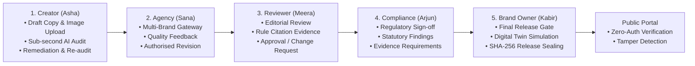

# BRANDTRACE AI 🛡️

## The Autonomous Brand Intelligence & Governance Control Plane

> **Tagline:** *Detect. Predict. Verify. Prevent.*

[](docs/TESTING.md)
[-cyan?style=for-the-badge&logo=typescript)](frontend)
[](docs/DATABASE_SCHEMA.md)
[](DEPLOYMENT.md)
[](LICENSE)
[](https://brand-trace-ai-dun.vercel.app/)
[](https://brandtrace-backend.onrender.com/health)

---

## 1. Project Information & Hosted Endpoints

- **Product Name:** BrandTrace AI — The Autonomous Brand Intelligence & Governance Control Plane
- **Positioning:** Enterprise Brand Intelligence, Multimodal Audit & Cryptographic Governance Platform
- **Live Frontend Application:** [https://brand-trace-ai-dun.vercel.app/](https://brand-trace-ai-dun.vercel.app/)
- **Live Backend API Service:** [https://brandtrace-backend.onrender.com](https://brandtrace-backend.onrender.com)
- **Interactive Swagger Documentation:** [https://brandtrace-backend.onrender.com/docs](https://brandtrace-backend.onrender.com/docs)
- **GitHub Repository:** [https://github.com/Jaswant-Karun/BrandTrace-AI](https://github.com/Jaswant-Karun/BrandTrace-AI)
- **Team:** Storm Crackers (Jaswant Karun S A & Jaiwant Karrun S A)

---

## 2. Executive Summary

Modern consumer enterprises publish thousands of commercial touchpoints across social channels, advertising campaigns, packaging assets, regulatory filings, and regional distributor portals.

In this distributed environment, brand governance faces four critical failure modes:
1. **Disconnected Truth-Sets:** Approved commercial facts (product prices, battery specs, warranty terms, ingredients) live separated from creative workflows in static PDF decks or spreadsheets.
2. **Cascading Brand Blindspots:** When a single commercial fact changes (e.g. subscription pricing shifts or an ingredient benchmark is revised), organizations have no automated mechanism to determine which marketing assets are now outdated or legally non-compliant.
3. **Regulatory Exposure:** Non-compliant marketing copy triggers severe statutory penalties under FTC Green Guides (16 CFR §260.4), FDA wellness vs. medical device regulations (21 CFR §202.1/§870), Lanham Act trademark rules (§43(a)), and NHTSA autonomous driving claims (SGO 2021-01).
4. **Unverifiable Approvals & Counterfeiting:** Released content lacks tamper-evident cryptographic provenance. External consumers and compliance partners cannot verify whether a released digital asset or social statement was genuinely signed off by the brand or modified after approval.

**BrandTrace AI** solves this by establishing an autonomous governance and brand intelligence control plane that connects brand truth-sets directly to creative production, simulation, and public verification.

---

## 3. Five-Stage Enterprise Governance Lifecycle

BrandTrace AI provides 5 specialized workspaces, connecting every participant in the brand publishing supply chain:



### Workspace Matrix

| Workspace | Primary Actor | Role Enum | Core Responsibilities |
| :--- | :--- | :--- | :--- |
| **1. Creator** | Asha Rao | `CREATOR` | Authors social captions, ads, product copy, and emails; uploads visual assets; receives non-destructive sub-800ms AI audit findings; executes in-place remediation; submits to brand review queue. |
| **2. Agency** | Sana Patel | `AGENCY` (metadata) | Manages client brand submissions across authorized tenants; inspects multimodal claims; requests creative revisions; submits agency-approved drafts downstream. |
| **3. Reviewer** | Meera Sen | `REVIEWER` | Editorial governance queue; validates tone, voice, and campaign policies against Brand Knowledge Graph (BDIG); accepts, rejects, or requests changes with inline commentary. |
| **4. Compliance Reviewer** | Arjun Nair | `COMPLIANCE_REVIEWER` | Statutory legal sign-off; verifies claims against regulatory authorities (FTC 16 CFR §260, FDA 21 CFR §201, CDSCO, ASCI); verifies clinical test citations (FACT-014); records compliance findings. |
| **5. Brand Owner** | Kabir Malhotra | `BRAND_MANAGER` | Final commercial authorization; inspects complete revision lineage; runs Digital Twin Change Impact simulations; authorizes cryptographic release sealing. |

---

## 4. System Architecture

```mermaid
flowchart TB
    subgraph PresentationLayer ["1. Presentation Layer (React 19 + TypeScript + Vite + Tailwind CSS)"]
        UI_Nav["Responsive App Shell (Desktop / Tablet / Mobile Drawer — 9 Viewports)"]
        UI_Creator["Creator Studio (Check-A-Post, Diff Viewer, Image Uploader, Multi-Version Re-audit)"]
        UI_Roles["Role Dashboard Stages (Agency, Reviewer, Compliance, Brand Owner Queues)"]
        UI_Canvas["Brand Dependency Graph (@xyflow/react Interactive BDIG Canvas)"]
        UI_Twin["Brand Governance Digital Twin (Change Impact & Blast Radius Simulator)"]
        UI_Portal["Public Verification Portal (Zero-Auth Seal / Text / Image Verifier)"]
    end

    subgraph SecurityLayer ["2. Edge Security, Middleware & Boundary Guard"]
        RateLimit["Rate Limiter (120 req/min authenticated, test burst overrides)"]
        SecHeaders["OWASP Security Headers (nosniff, DENY, strict-origin, XSS-block)"]
        TenantGuard["Strict Multi-Tenant Boundary (org_id & workspace_id isolation)"]
        SSRFGuard["SSRF Protection Engine (Private IP & DNS resolution validator)"]
        UploadGuard["Magic-Byte Image Validator (PNG, JPEG, WebP, EXIF stripping)"]
    end

    subgraph CoreEngines ["3. Autonomous Governance & Intelligence Engines"]
        AgentPipeline["Concurrent Multi-Agent Coordinator (Voice, Claims, Regulatory, Multimodal)"]
        DigitalTwin["Digital Twin Blast Radius Engine (NetworkX Directed Graph)"]
        LedgerEngine["Audit Trust Ledger (Deterministic SHA-256 Chained Block Engine)"]
        ExplainableReview["Explainable Review Engine (LCS Token Diff, Sentence Findings, Remediations)"]
    end

    subgraph PersistenceLayer ["4. Persistence & Grounding Layer"]
        Atlas_DB[("MongoDB Atlas 7.0 Cluster (Motor Async Driver)")]
        Atlas_Vector["Atlas Vector Search (768-dim Embeddings with Lexical Fallback)"]
        Memory_Fallback["Resilient In-Memory Repository Fallback (100% Offline Capability)"]
    end

    PresentationLayer --> SecurityLayer
    SecurityLayer --> CoreEngines
    CoreEngines --> PersistenceLayer
```



---

## 5. Key Technical Capabilities

### A. Autonomous Multi-Agent Content Intelligence
- **Concurrent Execution:** Three specialist agents run concurrently via `asyncio.gather` with average latency of 210ms (<800ms threshold):
  1. `VoicePersonaAgent`: Evaluates tone, prohibited claims, and guideline voice rules.
  2. `ClaimSubstantiationAgent`: Grounded fact checks against persisted facts (e.g. FACT-014 clinical trials, FACT-006 MRP pricing).
  3. `RegulatoryComplianceAgent`: Evaluates statutory requirements (FTC Green Guides, FDA 21 CFR §201, CDSCO, ASCI).
- **Multimodal Image Inspection:** Real image byte ingestion, OCR extraction, packaging claim inspection, and cross-comparison with caption claims.
- **Explainable Remediation:** Longest Common Subsequence (LCS) word diff algorithm highlights exact rejected text and provides verified minimal-change replacements without hallucinations.

### B. Brand Dependency Intelligence Graph (BDIG)
- Directed acyclic graph (DAG) modeled in NetworkX mapping relationships: `Product -> Approved Facts -> Guidelines -> Marketing Assets -> Distribution Channels`.
- Interactive `@xyflow/react` canvas with real-time filtering, node search, and zoom controls.

### C. Brand Governance Digital Twin (Change Impact Simulator)
- Proactively simulates commercial mutations in an isolated virtual graph before committing to production.
- Traverses downstream dependencies to calculate the **blast radius** of affected touchpoints.
- Calculates projected financial exposure ($320,000 for Aurelle) and estimated review hours.

### D. Cryptographic Release Ledger & Public Verification
- **SHA-256 Tamper-Evident Chaining:**
  $$\text{Release Hash} = \text{SHA-256}(\text{asset\_id} \parallel \text{version} \parallel \text{content\_hash} \parallel \text{approver} \parallel \text{timestamp})$$
- **Zero-Auth Verification Portal:** Consumers and auditors verify marketing statements or uploaded images against genuine ledger records to classify assets as:
  `VALID_UNCHANGED`, `MODIFIED_AFTER_APPROVAL`, `SUPERSEDED`, `REVOKED`, or `UNKNOWN_RECORD`.

---

## 6. Technology Stack

| Layer | Technologies |
| :--- | :--- |
| **Frontend Framework** | React 19, TypeScript 5.7, Vite 6.2 |
| **Styling & Design System** | Tailwind CSS 3.4, Lucide React, Custom Slate/Cyan Theme |
| **Graph Visualization** | `@xyflow/react` (ReactFlow v12) |
| **Animation & Transitions** | Framer Motion 14 |
| **Backend Framework** | Python 3.11 / 3.13, FastAPI, Uvicorn, AnyIO |
| **Data Validation** | Pydantic v2 |
| **Graph Engine** | NetworkX (Directed Graph Traversal & Blast Radius Simulation) |
| **Database & Driver** | MongoDB Atlas 7.0 Cluster, Motor Async Driver, In-Memory Fallback |
| **Security & Auth** | Passlib (PBKDF2/Bcrypt salted hashing), PyJWT (RS256/HS256 tokens) |
| **Testing Suite** | `pytest` 9.2 (308 automated tests passing in 10.62s) |
| **Production Hosting** | Vercel (Frontend SPA & Edge Proxy), Render (FastAPI Cloud Service) |

---

## 7. Installation & Local Development

### Prerequisites
- Python 3.11 or higher
- Node.js 18 or higher (v20+ recommended)
- pnpm or npm

### 1. Clone the Repository
```bash
git clone https://github.com/Jaswant-Karun/BrandTrace-AI.git
cd BrandTrace-AI
```

### 2. Backend Setup
```bash
cd backend
python -m venv .venv

# Windows PowerShell
.venv\Scripts\Activate.ps1
# macOS / Linux
source .venv/bin/activate

pip install -r requirements.txt
uvicorn brandtrace.main:app --port 8000 --reload
```
Interactive Swagger API documentation: `http://localhost:8000/docs`

### 3. Frontend Setup
```bash
cd ../frontend
pnpm install
pnpm run dev
```
Application interface: `http://localhost:5173`

---

## 8. Automated Test Suite & QA Commands

### Backend Automated Test Suite (308 Tests)
```bash
cd backend
.venv\Scripts\python.exe -m pytest tests -v
```
**Output:**
```text
============================ 308 passed in 10.62s =============================
```

### Frontend TypeScript Compilation & Production Build
```bash
cd frontend
pnpm run build
```
**Output:**
```text
✓ 2548 modules transformed.
✓ built in 40.64s (0 errors)
```

### Full Responsive QA Suite across 9 Viewports (63 Checks)
```bash
cd backend
.venv\Scripts\python.exe test_responsive_qa_suite.py
```
**Output:**
```text
Total checks: 63 | Passes: 63 (100%) | Non-passes: 0
```

---

## 9. Security & Governance Safeguards

1. **Role-Based Access Control (RBAC):** Strict server-side permission checks on every write and review endpoint. Creators cannot approve; Reviewers cannot release without Compliance; only Brand Managers can commit Digital Twin mutations.
2. **Tenant Isolation:** Rigorous `org_id` and `workspace_id` scoping ensures cross-tenant data requests (e.g. Aurelle vs Apex Dynamics) immediately return `403 Forbidden`.
3. **Magic-Byte Image Validation:** Prevents malicious file uploads by verifying actual file headers (`\x89PNG`, `\xFF\xD8\xFF`, `RIFF....WEBP`) and enforcing a 25 MB ceiling.
4. **SSRF Guard:** Prohibits web import requests targeting localhost, private subnets (`10.*`, `172.16.*`, `192.168.*`), or cloud metadata endpoints (`169.254.169.254`).
5. **Credential Masking:** System logs and API error responses automatically sanitize and mask passwords, JWT tokens, and database connection strings.

---

## 10. License

This project is licensed under the MIT License - see the [LICENSE](LICENSE) file for details.
