# BRANDTRACE AI 🛡️

## The Autonomous Brand Intelligence & Governance Control Plane

> **Tagline:** *Detect. Predict. Verify. Prevent.*

[](docs/TESTING.md)
[](frontend)
[](docs/DATABASE_SCHEMA.md)
[](DEPLOYMENT.md)
[](LICENSE)
[](https://brand-trace-ai-dun.vercel.app/)
[](https://brandtrace-backend.onrender.com/health)

---

## Hackathon Submission Details

- **Project Name:** BrandTrace AI — The Autonomous Brand Intelligence & Governance Control Plane
- **Team Name:** Storm Crackers
- **Team Leader:** Jaswant Karun S A
- **Team Member:** Jaiwant Karrun S A
- **Institution:** KPR Institute of Engineering and Technology
- **Live Frontend Application:** [https://brand-trace-ai-dun.vercel.app/](https://brand-trace-ai-dun.vercel.app/)
- **Live Backend API Service:** [https://brandtrace-backend.onrender.com](https://brandtrace-backend.onrender.com)
- **GitHub Repository:** [https://github.com/Jaswant-Karun/BrandTrace-AI](https://github.com/Jaswant-Karun/BrandTrace-AI)

---

## 1. Problem Statement

Modern consumer enterprises publish thousands of commercial touchpoints across social channels, advertising campaigns, packaging assets, regulatory filings, and regional distributor portals.

In this distributed environment, brand governance faces four critical failure modes:

1. **Disconnected Truth-Sets:** Approved commercial facts (product prices, battery specs, warranty terms, ingredients) live separated from marketing creative workflows in static PDF decks or spreadsheets.
2. **Cascading Brand Blindspots:** When a single commercial fact changes (e.g., a subscription price shifts from ₹499 to ₹599, or an engine thermal threshold is revised), teams have no mechanism to calculate which published or in-flight marketing assets are now outdated or legally non-compliant.
3. **Regulatory Exposure:** Non-compliant marketing copy triggers severe statutory penalties under FTC Green Guides (16 CFR §260.4), FDA wellness vs. medical device regulations (21 CFR §202.1/§870), Lanham Act trademark rules (§43(a)), and NHTSA autonomous driving claims (SGO 2021-01).
4. **Unverifiable Approvals & Counterfeiting:** Released content lacks tamper-evident cryptographic provenance. External consumers and compliance partners cannot verify whether a released digital asset or social statement was genuinely signed off by the brand or modified after approval.

---

## 2. Proposed Solution

**BrandTrace AI** is an autonomous governance and brand intelligence control plane that connects brand truth-sets directly to creative production, simulation, and public verification.

Rather than treating marketing copy as isolated strings of text, BrandTrace AI grounds every asset in a **Brand Dependency Intelligence Graph (BDIG)**. When marketing copy is submitted, an autonomous multi-agent reasoning gate inspects claims against verified guidelines and statutory rules under 800ms.

Before brand policies or commercial facts change, the **Brand Governance Digital Twin** simulates the change in a virtual sandbox, mapping the blast radius across downstream assets, quantifying financial exposure, and preventing silent brand contradictions before they happen. Once reviewed and authorized by designated human reviewers, releases receive a tamper-evident **SHA-256 Release Seal**, verifiable by anyone worldwide on the zero-auth **Public Verification Portal**.

---

## 3. Core System Architecture

```mermaid
flowchart TB
    subgraph PresentationLayer ["1. Presentation Layer (React 19 + TypeScript + Vite + Tailwind CSS)"]
        UI_Nav["Responsive App Shell (Desktop / Tablet / Mobile Drawer)"]
        UI_KB["Brand Knowledge Studio (Document Management, File Upload, SSRF Import)"]
        UI_Canvas["Brand Dependency Graph (@xyflow/react Interactive BDIG Canvas)"]
        UI_Twin["Brand Governance Digital Twin (Change Impact & Blast Radius Simulator)"]
        UI_Inspect["Multi-Agent Content Intelligence & Multimodal Inspector"]
        UI_Approvals["Human Governance Approval Center (Atomic Review Queue)"]
        UI_Portal["Public Verification Portal (Zero-Auth Seal / Text / Image Verifier)"]
    end

    subgraph SecurityLayer ["2. Edge Security, Middleware & Boundary Guard"]
        RateLimit["Rate Limiter (120 req/min authenticated, 60 req/min public)"]
        SecHeaders["OWASP Security Headers (nosniff, DENY, strict-origin, XSS-block)"]
        TenantGuard["Strict Multi-Tenant Boundary (org_id & workspace_id isolation)"]
        SSRFGuard["SSRF Protection Engine (Private IP & DNS resolution validator)"]
    end

    subgraph CoreEngines ["3. Autonomous Governance & Intelligence Engines"]
        DocEngine["Document Ingestion & Text Extraction Engine (PDF, DOCX, TXT, MD)"]
        AgentPipeline["Concurrent Multi-Agent Coordinator (Voice, Claims, Regulatory)"]
        DigitalTwin["Digital Twin Blast Radius Engine (NetworkX Directed Graph)"]
        LedgerEngine["Audit Trust Ledger (SHA-256 Tamper-Evident Chained Block Digests)"]
    end

    subgraph PersistenceLayer ["4. Persistence & Grounding Layer"]
        Atlas_DB[("MongoDB Atlas 7.0 Cluster (Motor Async Driver)")]
        Atlas_Vector["Atlas Vector Search (768-dim Embeddings with Lexical Fallback)"]
        Memory_Fallback["Resilient In-Memory Repository Fallback"]
    end

    PresentationLayer --> SecurityLayer
    SecurityLayer --> CoreEngines
    CoreEngines --> PersistenceLayer
```



---

## 4. Key Features & Working Capabilities

### A. Brand Knowledge Management & Document Studio

- **Custom Document Authoring:** Create and categorize documents across Brand Guidelines, Product Facts, Pricing Policies, Brand Voice, Regulatory Policies, and Marketing Claims.
- **Multi-Format Upload:** Upload and extract readable text from PDF, DOCX, TXT, and Markdown files.
- **SSRF-Protected Website Import:** Safely import public web pages with DNS rebinding protection and private IP range blocking (`10.*`, `172.16.*`, `192.168.*`, `127.0.0.1`, `169.254.169.254`).
- **Document Versioning:** Modifying an indexed document archives previous versions (e.g. `1.0`) and increments the active version (`1.1`).
- **Benchmark Protection:** Seeded demo benchmark documents are protected from deletion (`403 Forbidden`).

### B. Autonomous Multi-Agent Content Intelligence

- **Concurrent Inspection Pipeline:** Three specialist agents run concurrently via `asyncio.gather` with monotonic sub-800ms latency (average: 210ms):
  1. **VoicePersonaAgent:** Evaluates brand voice consistency, banned superlatives, and tonal alignment.
  2. **ClaimSubstantiationAgent:** Grounded claim verification against approved brand facts in MongoDB Atlas.
  3. **RegulatoryComplianceAgent:** Evaluates legal standards (FTC 16 CFR §260.4, FDA 21 CFR §202.1/§870, Lanham Act §43(a), NHTSA SGO 2021-01).
- **Non-Destructive Character Spans:** Returns exact character start and end offsets for non-destructive visual highlighting.

### C. Brand Governance Digital Twin (Change Impact Simulator)

- **Virtual Mutation Sandbox:** Propose price, policy, or specification mutations without modifying production data.
- **Blast Radius Mapping:** Traverses the BDIG directed graph to identify all directly and indirectly connected marketing touchpoints.
- **Financial & Workload Quantification:** Projects organizational dollar risk exposure and estimated departmental review hours.
- **Policy Contradiction Detection:** Surfaces direct contradictions and regulatory non-compliance before changes are committed.

### D. Human Governance & Atomic Approvals Gate

- **Strict Human-in-the-Loop:** Zero automatic publishing. All release candidates and fact mutations require explicit sign-off by an authorized role (`COMPLIANCE_REVIEWER`, `BRAND_MANAGER`, or `ADMIN`).
- **Atomic Task Resolution:** Reviewers accept, reject, or request revisions with mandatory audit notes.

### E. Cryptographic Release Ledger & Public Verification

- **SHA-256 Tamper-Evident Chaining:** Approved releases are sealed into an internal Merkle-style block chain:
  $$\text{Seal} = \text{SHA-256}(\text{rec\_id} \parallel \text{last\_block\_hash} \parallel \text{resource\_id} \parallel \text{content\_hash} \parallel \text{user\_identity} \parallel \text{timestamp})[:16]$$
- **Zero-Auth Public Verification Portal:** External consumers verify assets without signing in:
  - **Seal Code Lookup:** Validates seal codes against genuine ledger records.
  - **Text Canonicalization:** Ignores whitespace and quote styles (`"`, `'`, `“`, `”`) to verify text authenticity.
  - **Image Hash Matching:** Byte-level SHA-256 matching against registered visual assets.
  - **4-State Classification:** `APPROVED`, `OUTDATED`, `MODIFIED`, and `UNKNOWN`.
  - **Privacy Guarantee:** Zero leakage of reviewer emails, internal roles, or MongoDB `_id` identifiers.

---

## 5. Technology Stack

| Layer | Technologies |
| :--- | :--- |
| **Frontend Framework** | React 19, TypeScript 5.7, Vite 6.2 |
| **Styling & Icons** | Tailwind CSS 3.4, Lucide React |
| **Graph Visualization** | `@xyflow/react` (ReactFlow v12) |
| **Animation** | Framer Motion 14 |
| **Backend Framework** | Python 3.11 / 3.13, FastAPI, Uvicorn, AnyIO |
| **Data Validation** | Pydantic v2 |
| **Graph Intelligence** | NetworkX (Directed Dependency Graph) |
| **Database & Search** | MongoDB Atlas 7.0 (Async Motor Driver), Atlas Vector Search |
| **Cryptographic Ledger** | Python `hashlib` SHA-256 Merkle-style Chained Block Engine |
| **Testing Suite** | `pytest` 9.2 (163 automated unit and integration tests) |
| **Cloud Hosting** | Vercel (Frontend SPA & Edge Rewrites), Render (FastAPI Web Service) |

---

## 6. Installation & Local Setup

### Prerequisites

- Python 3.11 or higher
- Node.js 18 or higher (v20+ recommended)
- Git

### 1. Clone the Repository

```bash
git clone https://github.com/Jaswant-Karun/BrandTrace-AI.git
cd BrandTrace-AI
```

### 2. Backend Setup

```bash
cd backend
python -m venv .venv

# Windows
.venv\Scripts\activate
# macOS/Linux
source .venv/bin/activate

pip install -r requirements.txt
uvicorn brandtrace.main:app --port 8000 --reload
```

The backend API documentation will be available at: `http://localhost:8000/docs`

### 3. Frontend Setup

```bash
cd ../frontend
npm install
npm run dev
```

The frontend application will be accessible at: `http://localhost:5173`

---

## 7. Environment Variables Reference

Create a `.env` file in the `backend/` directory based on `.env.example`. **Never commit sensitive credentials.**

| Variable Name | Description | Example / Default |
| :--- | :--- | :--- |
| `ENVIRONMENT` | Runtime environment mode | `development` or `production` |
| `HOST` | Backend host address | `0.0.0.0` or `127.0.0.1` |
| `PORT` | Backend service port | `8000` |
| `DEBUG` | Enable verbose debugging | `true` or `false` |
| `MONGODB_URI` | MongoDB Atlas connection connection string | `mongodb+srv://<user>:<password>@cluster0.mongodb.net/brandtrace` |
| `MONGODB_DB_NAME` | Primary database name | `brandtrace` |
| `JWT_SECRET_KEY` | Secret key for signing JWT tokens | `<strong-random-secret-key>` |
| `GEMINI_API_KEY` | Optional Google Gemini API key for structured grounding | `<gemini-api-key>` |
| `ALLOWED_ORIGINS` | Comma-separated CORS allowed origins | `http://localhost:5173,https://brand-trace-ai-dun.vercel.app` |

---

## 8. Automated Test Suite

BrandTrace AI includes **163 automated tests** covering unit logic, multi-agent coordination, graph traversal, document parsing, SSRF defense, and cryptographic verification:

```bash
# Run the entire test suite from the project root:
backend\.venv\Scripts\pytest backend\tests -v -q --tb=short
```

**Results:**

```text
============================= 242 passed in 15.40s =============================
```

To run the frontend TypeScript and production build verification:

```bash
cd frontend
npm run build
```

---

## 9. Known Limitations & Responsible AI Disclosures

1. **Deterministic Heuristic vs. LLM Fallback:** When external LLM APIs are unreachable or unconfigured, the multi-agent engine falls back to deterministic rule and regex grounding. This ensures uninterrupted uptime and predictable latency (<800ms) during evaluation.
2. **Optical Character Recognition (OCR):** Image verification matches byte-level SHA-256 hashes against approved releases. Optical character reading from images requires system-level Tesseract binaries; if unavailable in cloud container environments, the portal relies on exact file hashing.
3. **Internal Cryptographic Ledger:** The release ledger uses an internal SHA-256 chained block digest mechanism. It does not write to an external public blockchain, avoiding excessive transaction fees, network latency, and carbon emissions while maintaining strict tamper-evidence within the enterprise governance boundary.
4. **Human Oversight Obligation:** BrandTrace AI is designed as a human-in-the-loop control plane. AI findings, risk scores, and blast radius calculations are advisory tools for compliance officers and brand managers; no release is published without explicit human authorization.

---

## 10. License

This project is licensed under the MIT License - see the [LICENSE](LICENSE) file for details.
