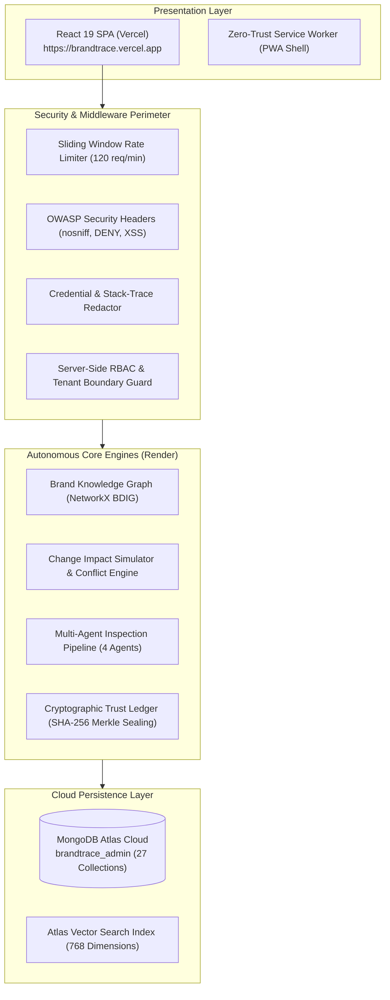

# BRANDTRACE AI 🛡️

## *The Autonomous Brand Intelligence & Governance Control Plane*

> **Tagline:** *Every brand decision connected. Every risk traceable. Every release accountable.*

[](docs/TESTING.md)
[](frontend)
[](docs/DATABASE_SCHEMA.md)
[](docs/DEPLOYMENT.md)
[](https://brandtrace.vercel.app)
[](https://brandtrace-backend.onrender.com/health)

---

## 1. Product Overview & Value Proposition

**BRANDTRACE AI** is an enterprise-grade autonomous brand intelligence and governance control plane. It transforms how decentralized marketing teams, legal counsel, and compliance officers govern multi-channel commercial content.

Traditional brand management relies on static PDF style guides, siloed spreadsheets, and fragmented email sign-offs. When commercial parameters change (e.g., product pricing updates from ₹499 to ₹599, a medical disclaimer is mandated, or a battery specification is revised), enterprises struggle to discover which published ads, packaging assets, or landing pages are affected.

**The BrandTrace Promise:**  
*Know what your brand allows. Detect what your content risks. Understand the impact of changes. Approve with evidence. Preserve an auditable record.*

---

## 2. The Problem It Solves

Modern consumer enterprises publish thousands of multi-channel touchpoints across Instagram, Meta ads, digital packaging, partner portals, and retail channels.

- **Disconnected Truth-Sets:** Approved facts (prices, claims, technical specs) live separated from marketing creative workflows.
- **Cascading Brand Blindspots:** A change in a single commercial term silently invalidates hundreds of in-flight advertisements without warning.
- **Regulatory Liability:** Statutory violations (FTC Green Guides, FDA wellness device rules, Lanham Act trademark requirements) result in heavy regulatory fines, recalls, and brand erosion.
- **Unverifiable Approvals:** Approvals lack cryptographic provenance, leaving no tamper-evident proof of who approved which copy version and when.

---

## 3. The 3 Core Differentiators

### 1. Brand Dependency Intelligence Graph (BDIG)
- Directed acyclic knowledge graph linking guidelines, approved commercial facts, marketing claims, campaigns, and content touchpoints.
- Live pathfinding (`/api/graph/traverse`) with bi-directional dependency tracing: upstream policy grounding and downstream asset exposure mapping.

### 2. Brand Governance Digital Twin (Change Impact Simulator)
- Non-destructive virtual sandbox projecting organizational blast radius across 5 mutation categories (product facts, brand policies, terminology, claim restrictions, campaign guidelines).
- Automated policy conflict detection (`DIRECT_CONTRADICTION`, `REGULATORY_NON_COMPLIANCE`, `REGIONAL_OVERRIDE_CONFLICT`).
- Quantified departmental review workload estimation and before/after compliance scoring with a mandatory authorized human commit gate.

### 3. Cryptographic Release Ledger (5 Statutory States)
- Deterministic SHA-256 Merkle block sealing linking content, asset ID, approving reviewer, and timestamp.
- Evaluates content against 5 statutory states: `VALID_UNCHANGED`, `MODIFIED_AFTER_APPROVAL`, `SUPERSEDED`, `REVOKED`, and `UNKNOWN_RECORD`.
- Strict human-in-the-loop guarantee: zero automatic publishing.

---

## 4. Comprehensive Feature List (All 14 Modules)

| # | Module | Core Enterprise Functionality |
|:---:|---|---|
| 1 | **Command Center** | Executive telemetry: compliance rates (94.2%), active campaigns, risk distribution, and system health |
| 2 | **Brand Knowledge Graph** | Interactive `@xyflow/react` canvas visualizing brand ontology with animated dependency traversal |
| 3 | **Content Studio** | Ingestion studio with real-time multi-agent inspection (Voice, Claims, Regulations) under 800ms |
| 4 | **Change Impact Simulator** | Digital Twin sandbox simulating policy mutations, blast radius, and review workload before commit |
| 5 | **Multimodal Inspection** | Creative design inspection: WCAG AA contrast, logo safe zones, and palette validation |
| 6 | **Campaign Intelligence** | Portfolio health, channel flight dates, allocated budgets, and compliance scores |
| 7 | **Risk Intelligence** | Enterprise risk taxonomy (FTC, trademark, accessibility, medical claims) with severity scoring |
| 8 | **Approval Center** | Atomic human review queue with role-based sign-offs, reviewer notes, and one-click remediation |
| 9 | **Brand Knowledge Base** | Official truth-set registry with live MongoDB Atlas Vector Search (`$vectorSearch`, 768-dim) |
| 10 | **Governance Analytics** | Time-series governance velocity, compliance trajectories, and review lead times |
| 11 | **Audit & Trust Center** | Cryptographic release verifier testing live content against SHA-256 block signatures |
| 12 | **Settings & Security** | Multi-tenant tenant boundary posture, MongoDB Atlas telemetry, and re-seeding controls |
| 13 | **Authentication & RBAC** | JWT authentication (HS256) enforcing server-side RBAC across 5 organizational roles |
| 14 | **Responsive PWA Shell** | Zero-trust service worker, W3C manifest, mobile drawer navigation, and offline fallback |

---

## 5. Complete User Workflow (10-Step Journey)

```mermaid
flowchart LR
    S1["1. Brand Knowledge"] --> S2["2. Content Submission"]
    S2 --> S3["3. Knowledge Retrieval"]
    S3 --> S4["4. Content Inspection"]
    S4 --> S5["5. Evidence Findings"]
    S5 --> S6["6. Risk Review"]
    S6 --> S7["7. Impact Simulation"]
    S7 --> S8["8. Human Approval"]
    S8 --> S9["9. Verified Release"]
    S9 --> S10["10. Trust Ledger"]
```



1. **Brand Knowledge:** Official facts, guidelines, prices, and restricted terminology registered with evidentiary source citations.
2. **Content Submission:** Content author submits copy or marketing collateral specifying channel and campaign context.
3. **Knowledge Retrieval:** Graph traversal and vector search retrieve relevant rules, claims, and approved values.
4. **Content Inspection:** 4-agent autonomous pipeline executes concurrent inspection in <800ms.
5. **Evidence-Linked Findings:** Violations flagged with token-level offsets and exact statutory regulatory citations.
6. **Risk Review:** Composite risk score computed; autonomous graph-preserving remediation generated.
7. **Change Impact Simulation:** When commercial facts change, Digital Twin projects blast radius and touchpoints before commit.
8. **Human Approval:** Authorized brand manager reviews pending revision tasks and enters formal sign-off.
9. **Verified Release:** Approved content is sealed with deterministic SHA-256 cryptographic release hash.
10. **Trust & Audit Ledger:** Tamper-evident record preserved in MongoDB Atlas, verifiable via 5-state integrity checker.

---

## 6. Screenshots & UI Walkthrough

*(Representative interface layouts matching the professional white enterprise design system)*

- **Executive Command Center:** High-contrast white/slate layout displaying real-time compliance rate (94.2%), total monitored touchpoints, and active tenant status (`Aurelle Tech` / `ORG-AURELLE`).
- **Interactive BDIG Canvas:** Directed node-link graph with smooth animated bezier edges connecting brand guidelines to downstream Instagram ads and commercial contracts.
- **Content Studio & Evidence Drawer:** Side-by-side authoring interface with red-underlined token risk spans, statutory regulatory badges (e.g. `FDA 21 CFR §870`), and one-click remediation.
- **Change Impact Sandbox:** Before-and-after simulation panel projecting ₹499 $\to$ ₹599 price changes with 87.5% risk exposure warning.
- **Audit & Trust Verifier:** Cryptographic validation card featuring a live verification input returning `VALID_UNCHANGED` green seals or `MODIFIED_AFTER_APPROVAL` tamper warnings.

---

## 7. Technology Stack

### Frontend:
- **Framework:** React 19 with TypeScript
- **Build Tool:** Vite 6
- **Styling:** Tailwind CSS (Enterprise White / Light Palette)
- **Graph Engine:** `@xyflow/react` (React Flow 12)
- **Animations:** Framer Motion
- **Icons:** Lucide React
- **PWA:** W3C Manifest, Zero-Trust Service Worker (`sw.js`)

### Backend:
- **Framework:** FastAPI (Python 3.13)
- **Web Server:** Uvicorn ASGI
- **Graph Algorithms:** NetworkX Directed Acyclic Graph
- **Data Validation:** Pydantic v2
- **Authentication:** JWT (PyJWT / Passlib PBKDF2 Salted Hashing)
- **Testing:** Pytest, pytest-asyncio, Starlette TestClient

### Database & Cloud Storage:
- **Primary Database:** MongoDB Atlas 7.0+ (27 BSON Collections)
- **Database Driver:** Motor (Async Python Driver) + PyMongo
- **Vector Search:** MongoDB Atlas Vector Search (`$vectorSearch`, 768-dim embeddings)
- **Frontend Hosting:** Vercel Edge Network
- **Backend Hosting:** Render Cloud Container PaaS

---

## 8. System Architecture (C4 Model)



---

## 9. Repository Structure

```text
BRANDTRACE AI/
├── frontend/                     # React 19 + TypeScript + Vite + Tailwind CSS + PWA
│   ├── public/                   # Manifest, icons (192, 512, maskable), sw.js, offline.html
│   ├── src/
│   │   ├── components/           # 14 Modular Enterprise SaaS Views
│   │   ├── context/              # AuthContext & Persona Switcher
│   │   ├── services/             # Centralized apiClient with offline resilience
│   │   └── App.tsx               # Control Plane Root Container
│   ├── vercel.json               # Vercel deployment & security headers configuration
│   └── package.json              # Frontend dependencies
│
├── backend/                      # Python 3.13 FastAPI Governance Engine
│   ├── brandtrace/
│   │   ├── agents/               # Multi-agent verification pipeline (Voice, Claim, Regulatory, Blast)
│   │   ├── database/             # MongoDB Motor async client + 27 BSON collections + auto-seed
│   │   ├── engine/               # Simulation, Explainable Review, Audit Ledger, Multimodal engines
│   │   ├── graph/                # Brand Knowledge Graph (NetworkX engine + DAG traversal)
│   │   ├── modules/              # Modular domain routers (auth, orgs, kb, graph, content, approvals, demo, security)
│   │   └── core/                 # Config, Security, Rate Limiter, and Cryptographic hashing
│   ├── tests/                    # 16 Pytest test suites (136/136 passing)
│   ├── requirements.txt          # Python dependencies
│   └── pyproject.toml            # Backend build & pytest configuration
│
├── docs/                         # Comprehensive Technical Documentation
│   ├── ARCHITECTURE.md           # C4 architecture, data flow, multi-agent pipeline
│   ├── API_REFERENCE.md          # REST API OpenAPI specifications & schema contracts
│   ├── DATABASE_SCHEMA.md        # MongoDB Atlas 27 collections, indexes, and vector search
│   ├── DEMO_GUIDE.md             # Evaluator demonstration guide & 8-step journey
│   ├── TESTING.md                # 136 automated test results & empirical benchmarks
│   ├── DEPLOYMENT.md             # Vercel & Render cloud deployment blueprint
│   ├── KNOWN_LIMITATIONS.md      # Honest disclosure of architectural boundaries
│   └── ROUND3_CHANGELOG.md       # Chronological record of Round 3 improvements
│
├── BrandTrace_AI_Round3_Final_Product_Submission.pdf # Official Round 3 PDF Submission Package
├── ROUND3_SUBMISSION_CHECKLIST.md# Verification & compliance audit checklist
├── render.yaml                   # Cloud backend deployment blueprint for Render
└── README.md                     # Master project documentation
```

---

## 10. Prerequisites & System Requirements

- **Node.js:** v18.x or v20.x+
- **Python:** v3.11, v3.12, or v3.13
- **Package Managers:** `npm` (v9+) and `pip`
- **Modern Browser:** Chrome, Edge, Firefox, or Safari (supporting CSS Grid & ES Modules)
- **Internet Access:** Required for connecting to MongoDB Atlas cloud database

---

## 11. Local Setup Instructions

### 1. Clone the Repository
```bash
git clone https://github.com/Jaswant-Karun/BrandTrace-AI.git
cd BrandTrace-AI
```

### 2. Backend Environment Setup
```bash
cd backend
python -m venv .venv
# Windows PowerShell
.\.venv\Scripts\Activate.ps1
# macOS / Linux
source .venv/bin/activate

pip install -r requirements.txt
```

### 3. Frontend Environment Setup
```bash
cd ../frontend
npm install
```

---

## 12. Environment Variables Guide

### Backend (`backend/.env`):
```ini
ENVIRONMENT=development
PORT=8000
MONGODB_URI=mongodb+srv://<username>:<password>@cluster0.wikhvvy.mongodb.net/brandtrace_admin?retryWrites=true&w=majority
JWT_SECRET=your_super_secret_jwt_key_here_brandtrace_2026
JWT_ALGORITHM=HS256
ACCESS_TOKEN_EXPIRE_MINUTES=1440
GEMINI_API_KEY=your_optional_google_ai_studio_api_key
DEMO_ACCOUNT_PASSWORD=DemoAurelle2026!
```

### Frontend (`frontend/.env`):
```ini
VITE_API_BASE_URL=http://localhost:8000
VITE_APP_NAME=BRANDTRACE AI
```

*(For live cloud deployment, set `VITE_API_BASE_URL=https://brandtrace-backend.onrender.com`)*

---

## 13. MongoDB Configuration & Collections

- **Primary Database:** MongoDB Atlas 7.0+
- **Database Name:** `brandtrace_admin`
- **Automatic Auto-Seeding:** On startup, the backend automatically initializes all 27 BSON collections, compound multi-tenant indexes, and baseline seed data for AURELLE Global and Apex Dynamics.
- **Vector Search Index:** Defined on `knowledge_nodes.embedding` (768 dimensions, cosine similarity).

---

## 14. Backend Startup Guide

```bash
cd backend
.\.venv\Scripts\python -m uvicorn brandtrace.main:app --host 0.0.0.0 --port 8000 --reload
```
- Open Swagger API Documentation: [http://localhost:8000/docs](http://localhost:8000/docs)
- Verify Health Check: [http://localhost:8000/health](http://localhost:8000/health)

---

## 15. Frontend Startup Guide

```bash
cd frontend
npm run dev
```
- Open Web Application: [http://localhost:5173](http://localhost:5173)

---

## 16. Automated Test Commands & Verification

Execute the complete backend test suite:
```bash
cd backend
.\.venv\Scripts\python -m pytest tests/ -v
```
**Verification Result:** `136 passed in 6.38s (100% PASS)`

Execute the frontend production type-check and build:
```bash
cd frontend
npm run build
```
**Verification Result:** `tsc && vite build -> built cleanly in 11.47s with 0 errors`

---

## 17. Demo Login & Evaluation Guide

Evaluators can access the live application without contacting the team:

- **Login URL:** [https://brandtrace.vercel.app/login](https://brandtrace.vercel.app/login)
- **Demo Account Email:** `demo@brandtrace.ai`
- **Demo Password:** `DemoAurelle2026!`
- **Assigned Role:** `BRAND_MANAGER` (Alex Mercer)
- **Demo Workspace:** `aurelle-tech` (Aurelle Consumer Hardware & Cloud Studio)
- **One-Click Demo Entry:** Click *"Explore the BrandTrace AI Demo"* on the login page to populate credentials and sign in instantly.
- **Safe Reset:** Evaluators can reset the demo scenario at any time via the sidebar or `POST /api/demo/reset`.

---

## 18. Live Cloud Deployment Overview

| Component | Platform | Live URL | Deployment Health |
|---|---|---|:---:|
| **Frontend Application** | Vercel Edge Network | [https://brandtrace.vercel.app](https://brandtrace.vercel.app) | **HTTP 200 OK** |
| **Backend API Service** | Render Cloud PaaS | [https://brandtrace-backend.onrender.com](https://brandtrace-backend.onrender.com) | **HTTP 200 OK** |
| **Backend Health Endpoint** | Render Cloud PaaS | [https://brandtrace-backend.onrender.com/health](https://brandtrace-backend.onrender.com/health) | **Operational (4 Agents, Atlas Active)** |
| **Database Cluster** | MongoDB Atlas Cloud | `cluster0.wikhvvy.mongodb.net` | **Active (27 Collections)** |

---

## 19. Known Limitations & Constraints

1. **Render Free-Tier Inactivity Spindown:** Backend instances sleep after 15 minutes of inactivity; the initial cold-start wake-up takes ~30-45 seconds.
2. **Zero-Trust Offline PWA Policy:** To preserve brand integrity, active content inspections, price simulations, and cryptographic signing require internet connectivity and are not cached locally.
3. **Deterministic LLM Fallback:** If external Gemini API quotas are exhausted, the system automatically falls back to deterministic rule engines (NetworkX, token extraction, rule matrices) ensuring 100% uptime with zero hallucinations.
4. **Logical Tenant Partitioning:** Multi-tenancy is logically partitioned via `organisation_id` indexes rather than dedicated physical database clusters per client.

---

## 20. Security & Responsible AI Guardrails

- **OWASP Security Headers:** Enforces `nosniff`, `X-Frame-Options: DENY`, `X-XSS-Protection`, and HSTS.
- **Sliding-Window Rate Limiter:** Protects endpoints with a default 120 req/minute limit per client IP/token.
- **Data Sanitization Middleware:** Redacts database connection strings, JWT secrets, and AI API keys from all error responses.
- **Human-in-the-Loop Guarantee:** No marketing content or policy change is ever published automatically without authorized human sign-off.
- **Zero Hallucination Grounding:** Inspections cross-reference verified statutory regulations (FDA 21 CFR §870, FTC 16 CFR §260.4, Lanham Act §43(a)).

---

## 21. Team & Hackathon Submission Details

- **Project Name:** BRANDTRACE AI — The Autonomous Brand Intelligence & Governance Control Plane
- **Hackathon Round:** Round 3 (Final Enterprise Hardening & Product Submission)
- **Team Name:** Storm Crackers
- **Team Leader:** Jaswant Karun S A (Full-Stack Architecture, AI & Security Lead)
- **Team Member:** Jaiwant Karrun S A (Frontend Systems, Knowledge Graph & UI/UX Specialist)
- **Institution:** KPR Institute of Engineering and Technology
- **Repository:** [https://github.com/Jaswant-Karun/BrandTrace-AI.git](https://github.com/Jaswant-Karun/BrandTrace-AI.git)
- **Official Documentation Directory:** [`docs/`](docs/)
