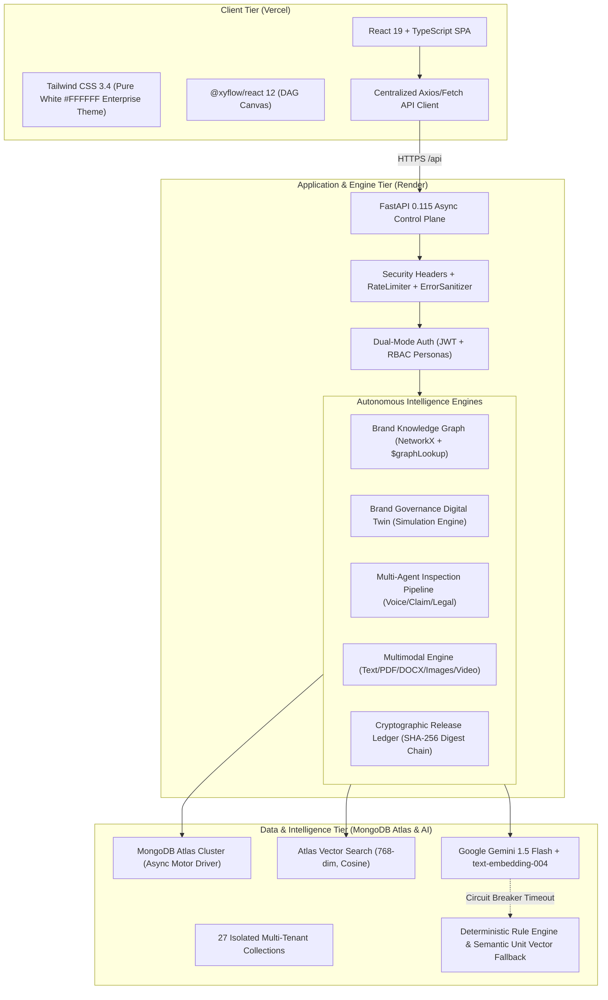
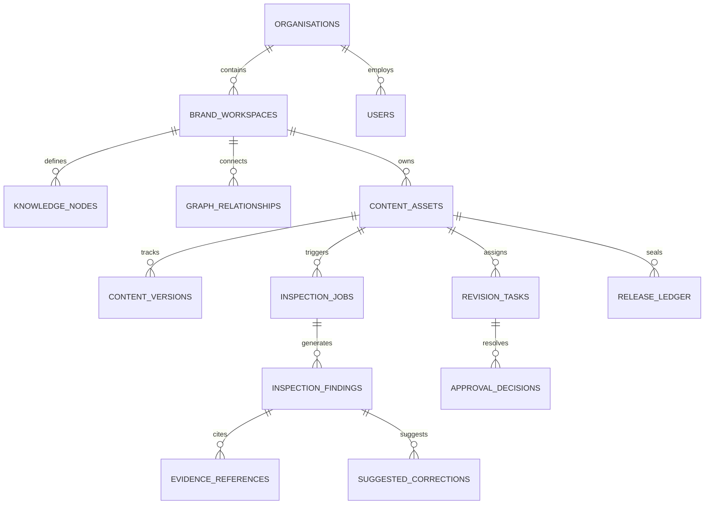
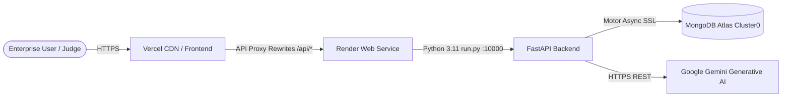

# BRANDTRACE AI — Round 3 Current Technical Architecture

**Project Identity:** BRANDTRACE AI — The Autonomous Brand Intelligence & Governance Control Plane  
**Tagline:** *Every brand decision connected. Every risk traceable. Every release accountable.*  
**Team:** Storm Crackers (Jaswant Karun S A, Jaiwant Karrun S A)  
**Version:** 2.0.0 (Enterprise Production Hardened)  
**Audit Date:** November 14, 2026  

---

## 1. High-Level System Architecture

BrandTrace AI is architected as a decoupled, multi-tenant enterprise control plane providing autonomous brand intelligence, prospective change impact simulation, multi-agent content governance, and cryptographic release assurance:



---

## 2. Technology Stack & Runtime Specifications

| Tier | Component / Technology | Version / Specification | Rationale & Enterprise Role |
| :--- | :--- | :--- | :--- |
| **Frontend Framework** | React | 19.0.0 | High-performance reactive rendering with optimized DOM updates. |
| **Language (Frontend)** | TypeScript | 5.7.3 | Strict compile-time type safety (`tsc --noEmit` clean). |
| **Bundler & Tooling** | Vite | 6.2.0 | Sub-second HMR development and optimized production bundling (28.87s build). |
| **Canvas & DAGs** | `@xyflow/react` | 12.4.4 | Hardware-accelerated SVG/HTML5 canvas for Brand Dependency Graphs. |
| **Styling & Design** | Tailwind CSS | 3.4.17 | Pure white (`#FFFFFF`) enterprise UI theme with Slate typography. |
| **Icons & Motion** | Lucide React + Framer Motion | 0.475.0 / 12.4.7 | Enterprise glyphs and micro-interactions for layout transitions. |
| **Backend Framework** | FastAPI | 0.115.11 | High-throughput asynchronous Python web framework (ASGI). |
| **Language (Backend)** | Python | 3.13.5 / 3.11.9 (Render) | Modern asynchronous coroutines (`async`/`await`) and type hinting. |
| **Data Validation** | Pydantic | 2.10.6 | Strict schema serialization, input parsing, and data validation. |
| **Database Engine** | MongoDB Atlas | 7.0+ Cluster | Multi-tenant document persistence with `$graphLookup` and `$vectorSearch`. |
| **Database Driver** | Motor | 3.7.0 (AsyncIOMotorClient) | Non-blocking asynchronous MongoDB driver for high concurrency. |
| **AI Models** | Google Gemini | `gemini-1.5-flash` / `text-embedding-004` | Structured brand grounding, semantics, and high-velocity embedding. |
| **Graph Algorithms** | NetworkX | 3.4.2 | Directed Acyclic Graph (DAG) reachability, cycle detection, and traversals. |
| **Computer Vision** | OpenCV + Pillow + NumPy | 4.11.0 / 11.1.0 / 2.2.3 | Video keyframe extraction, dominant color analysis, and WCAG contrast. |
| **Document Parsers** | pypdf + python-docx | 5.3.1 / 1.1.2 | Layered text extraction from corporate PDFs, brand die-lines, and DOCX. |
| **Testing Suite** | Pytest + AnyIO + HTTPX | 9.2.0 / 4.16.0 / 0.28.1 | 77 automated test cases covering unit, integration, and E2E journeys. |

---

## 3. Frontend Architecture (14 Cohesive Views)

### 3.1 Component Hierarchy & Code-Splitting

The frontend is built with React 19 and utilizes dynamic `React.lazy` code-splitting in [App.tsx](file:///C:/Users/jaswant%20karun/BRANDTRACE%20AI/frontend/src/App.tsx) to ensure lightning-fast initial page loads:

```text
frontend/src/
├── App.tsx                     # Core application layout, code-split routing, workspace context
├── main.tsx                    # React 19 root bootstrap with AuthProvider
├── index.css                   # Tailwind CSS styling, animations, custom scrollbars
├── types/                      # TypeScript domain definitions (BrandProfile, DatabaseStatus, etc.)
├── context/
│   └── AuthContext.tsx         # Enterprise JWT context, tenant workspace selector, role state
├── services/
│   └── apiClient.ts            # Centralized API client with JWT injection and error normalization
└── components/
    ├── LandingPage.tsx         # Public enterprise landing page with live entry points
    ├── LoginPage.tsx           # Dual-mode authentication (Sign In, Register, Persona Switcher)
    ├── CommandCenter.tsx       # Executive governance cockpit and compliance rate counters
    ├── KnowledgeGraphView.tsx  # Interactive @xyflow/react Brand Dependency Intelligence Graph
    ├── BrandNode.tsx           # Custom React Flow node with category badges & status rings
    ├── AssetInspector.tsx      # Content Intelligence Studio with multi-agent review & rewrites
    ├── BlastRadiusSimulator.tsx# Brand Governance Digital Twin prospective change simulator
    ├── MultimodalInspectionView.tsx # Multi-format inspector (Text, PDF, Images, Video keyframes)
    ├── CampaignIntelligenceView.tsx # Portfolio view of active campaigns and blast radius risk
    ├── RiskIntelligenceView.tsx # Regulatory taxonomy matrix across statutory jurisdictions
    ├── ApprovalCenterView.tsx  # Human-in-the-loop task queue with atomic approval gates
    ├── BrandKnowledgeBaseView.tsx # Approved facts catalog with Atlas Vector Search query bar
    ├── GovernanceAnalyticsView.tsx # SLA lead times, agent precision/recall, and velocity charts
    ├── AuditTrustCenterView.tsx# Cryptographic 5-state integrity verifier and audit ledger
    ├── ReleaseLedgerView.tsx   # Historical release records with Merkle-style block seals
    ├── SettingsView.tsx        # Tenant configuration, database status, and 1-click reseed
    ├── DatabaseStatusModal.tsx # Real-time MongoDB Atlas telemetry modal
    ├── DemoWalkthroughModal.tsx# Guided interactive evaluator tour with 1-click step runner
    ├── GuidedTourOverlay.tsx   # Step-by-step spotlight overlay guiding new evaluators
    ├── WelcomeModal.tsx        # Enterprise onboarding welcome banner
    ├── AuthHeader.tsx          # Top navigation bar with workspace switcher & user profile
    ├── Navbar.tsx              # Quick action header bar
    └── Sidebar.tsx             # Collapsible primary navigation sidebar
```

### 3.2 State Management & Centralized API Client

- **`AuthContext.tsx`:** Manages user authentication state, current organization (`org_id`), active workspace (`workspace_id`), and user role (`ADMIN`, `BRAND_MANAGER`, `COMPLIANCE_REVIEWER`, `REVIEWER`, `CREATOR`).
- **`apiClient.ts`:** Automatically injects `Authorization: Bearer <token>` into outgoing requests, normalizes HTTP 4xx/5xx responses into typed `ApiError` objects, and encapsulates domain methods across `auth`, `organizations`, `knowledgeBase`, `graph`, `approvals`, `content`, and `demo`.

---

## 4. Backend Modular Architecture (FastAPI)

### 4.1 Application Pipeline & Middlewares

In [backend/brandtrace/main.py](file:///C:/Users/jaswant%20karun/BRANDTRACE%20AI/backend/brandtrace/main.py), requests flow through a layered middleware pipeline:

1. **`ErrorSanitizationMiddleware`:** Intercepts unhandled exceptions, sanitizes sensitive stack traces, and returns clean, uniform JSON error structures.
2. **`SecurityHeadersMiddleware`:** Enforces standard enterprise headers (`X-Content-Type-Options: nosniff`, `X-Frame-Options: DENY`, `X-XSS-Protection: 1; mode=block`).
3. **`RateLimitMiddleware`:** Enforces rate limiting (120 requests/minute per client IP) to protect against volumetric abuse.
4. **`CORSMiddleware`:** Permits cross-origin requests from configured origins (`ALLOWED_ORIGINS`).

### 4.2 Router Architecture

The API exposes endpoints structured across core legacy routes and modular business domain routers:

```text
backend/brandtrace/
├── main.py                     # FastAPI application factory, lifespan startup, health check
├── run.py                      # Dynamic port runner for Render ($PORT / 10000)
├── core/
│   ├── config.py               # Pydantic Settings (MongoDB URI, Gemini Key, Environment)
│   ├── security.py             # JWT encode/decode, bcrypt/SHA-256 salted password hashing
│   └── middleware.py           # Rate limiting, security headers, error sanitization
├── database/
│   ├── mongo.py                # MongoManager with connection pooling & production guards
│   ├── repository.py           # BrandTraceRepository with immutable _id upsert protection
│   ├── schemas.py              # Pydantic models for all 27 MongoDB Atlas collections
│   ├── indexes.py              # Unique, compound, and vector index generators
│   └── seeding.py              # Multi-tenant enterprise seed data generators
├── engine/
│   ├── ai_provider.py          # GeminiProvider with 768-dim embedding & deterministic fallback
│   ├── audit_ledger.py         # AuditTrustLedger with 5-state verifier & SHA-256 block chain
│   ├── collaboration.py        # RBAC user definitions and governance audit events
│   ├── explainable_review.py   # Multi-agent inspection & reverse-offset remediation
│   ├── multimodal.py           # MultimodalContentEngine (PDF, DOCX, Pillow, OpenCV)
│   ├── simulation.py           # ChangeImpactSimulationEngine (Digital Twin DAG sandbox)
│   └── storage_provider.py     # Local file storage with extension & size validation
├── graph/
│   ├── engine.py               # BrandKnowledgeGraph NetworkX ontology
│   ├── dependency_engine.py    # Fact mutation cascading and task generation
│   └── schema.py               # Node, edge, and revision task Pydantic definitions
├── modules/
│   ├── auth/                   # /api/auth (Login, Register, Me, Personas)
│   ├── organizations/          # /api/organizations (Tenants & Workspaces)
│   ├── knowledge_base/         # /api/knowledge-base (Atlas Vector Search & Facts)
│   ├── graph_intelligence/     # /api/graph-intelligence (Relationships & Traversals)
│   ├── content/                # /api/content (File storage & metadata)
│   ├── approvals/              # /api/approvals (Atomic task resolutions)
│   ├── demo/                   # /api/demo (Repeatable 12-step evaluator workflow)
│   └── security/               # /api/security (RBAC postures & 22-case benchmark)
└── routes/
    └── api.py                  # Core governance endpoints (verify, simulate, ledger, etc.)
```

---

## 5. Database Schema & Collections Architecture (27 Collections)

The database schema is organized into five functional partitions, ensuring strict multi-tenant isolation and referential integrity:



### Complete Collection Inventory

1. **`users`:** User accounts, roles, departments, and password hashes.
2. **`organisations`:** Multi-tenant enterprise accounts (e.g. Aurelle Luxury Group, Apex Dynamics).
3. **`workspace_memberships`:** User-to-workspace role and permission mappings.
4. **`brand_workspaces`:** Brand subdivisions (e.g. `aurelle-tech`, `aurelle-maison`).
5. **`roles_permissions`:** Granular RBAC definitions and allowed action lists.
6. **`brand_guidelines`:** Master governance policies, voice mandates, and design constraints.
7. **`guideline_versions`:** Version history for brand policies.
8. **`approved_facts`:** Authoritative product specs, pricing, and ingredients.
9. **`fact_sources`:** External legal certificates, lab reports, and regulatory filings.
10. **`terminology`:** Approved trademarks, prohibited words, and restricted claims.
11. **`brand_assets`:** Official logos, typography assets, packaging die-lines.
12. **`campaigns`:** Marketing campaigns, flight dates, allocated budgets, and channels.
13. **`content_assets`:** Monitored marketing assets across OOH, Web, Social, and PR.
14. **`content_versions`:** Historical content bodies, revision notes, and content hashes.
15. **`graph_nodes`:** DAG nodes representing facts, policies, assets, and campaigns.
16. **`graph_relationships`:** DAG edges representing `DEPENDS_ON_FACT`, `CITES_CLAIM`, etc.
17. **`knowledge_nodes`:** Unified knowledge store with 768-dim embeddings for vector search.
18. **`inspection_jobs`:** Inspection execution records and composite risk scores.
19. **`inspection_findings`:** Specific policy, factual, or legal infractions found.
20. **`evidence_references`:** Statutory legal citations (FTC 16 CFR §260.4, FDA, NHTSA).
21. **`suggested_corrections`:** Minimal-change rewrites preserving brand voice.
22. **`review_assignments`:** Task routing to designated human reviewers.
23. **`comments`:** Threaded collaboration notes and reviewer annotations.
24. **`approval_decisions`:** Human approval decisions with cryptographic seal records.
25. **`change_simulations`:** Prospective Digital Twin change proposals.
26. **`impact_reports`:** Projected blast radius, affected touchpoints, and financial risk.
27. **`release_ledger`:** Immutable cryptographic release blocks and 5-state integrity records.

---

## 6. Multi-Agent Reasoning & Cryptographic Assurance

### 6.1 Multi-Agent Pipeline Topology

When content is submitted for inspection, three autonomous agents execute concurrently:

1. **Voice & Persona Agent:** Computes linguistic formality, tonal consistency, and lexical deviations from brand identity directives.
2. **Claim Substantiation Agent:** Extracts all numerical, superlative, and factual assertions, verifying them against the Brand Knowledge Graph catalog.
3. **Regulatory Compliance Agent:** Cross-examines content against federal and international advertising statutes (FTC Green Guides, FDA 21 CFR §202.1/§870, Lanham Act §43(a), NHTSA SGO 2021-01).

### 6.2 Reverse-Offset Remediation Synthesizer

To guarantee that 1-click rewrites do not alter or corrupt adjacent text spans, the engine sorts all detected findings in descending order of character start offsets (`sorted(findings, key=lambda f: f.start_offset, reverse=True)`). Replacements are injected from the end of the text string to the beginning, preserving earlier character index alignments.

### 6.3 5-State Cryptographic Release Ledger

Upon authorized sign-off, the release engine computes a chained SHA-256 Merkle block:

$$\text{Block Material} = \text{rec\_id} \parallel \text{last\_block\_hash} \parallel \text{resource\_id} \parallel \text{content\_hash} \parallel \text{user\_identity} \parallel \text{timestamp}$$

$$\text{Seal} = \text{"BT-SEAL-"} \parallel \text{SHA-256}(\text{Block Material})[0:16]$$

The verifier checks any content string against this immutable ledger, deterministically categorizing it into:

- `VALID_UNCHANGED`
- `MODIFIED_AFTER_APPROVAL`
- `SUPERSEDED`
- `REVOKED`
- `UNKNOWN_RECORD`

---

## 7. Cloud Deployment Topology



- **Frontend Deployment (Vercel):** Configured via `frontend/vercel.json` with automatic proxying of `/api/*` and `/health` to the Render backend, preventing CORS issues in enterprise networks.
- **Backend Deployment (Render):** Dockerized web service running `python run.py`, dynamically reading the `$PORT` environment variable (Render port 10000) and maintaining persistent connection pools to MongoDB Atlas.
