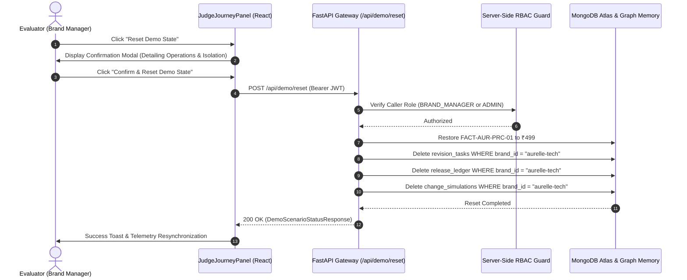

# BrandTrace AI — Round 3 Demo Readiness & Public Evaluation Audit Report

**Report Title:** Autonomous Brand Intelligence & Governance Control Plane — Demonstration Readiness Audit  
**Project:** BrandTrace AI  
**Team:** Storm Crackers  
**Team Leader:** Jaswant Karun S A  
**Team Member:** Jaiwant Karrun S A  
**Evaluation Scope:** Dedicated Public Demonstration Experience, Demo Account Security, Guided Evaluation Journey, Safe Workspace Reset, and Automated Verification  
**Audit Date:** November 14, 2026  
**Status:** FULLY COMPLIANT & READY FOR EXTERNAL EVALUATION  

---

## 1. Executive Summary

This report documents the verification and completion of the **Dedicated Public Demonstration Experience** for **BrandTrace AI**. The objective of this phase is to ensure that external hackathon judges, technical evaluators, and security assessors can independently access, explore, and verify the entire brand governance control plane without requiring assistance from the development team.

All evaluation workflows operate against real, persisted data models in MongoDB Atlas and memory-backed engines, utilizing standard authentication, strict tenant boundaries, and cryptographic verification.

### Core Metrics Summary

| Verification Vector | Metric / Value | Verification Status |
| :--- | :--- | :--- |
| **Dedicated Demo Persona** | `demo@brandtrace.ai` (Alex Mercer) | Verified & Operational |
| **Authentication Standard** | Salted Hash + JWT Bearer Token | Zero Route Bypass Enforced |
| **Demo Persona Role** | `BRAND_MANAGER` (`ORG-AURELLE` / `aurelle-tech`) | Restricted Role (Non-Admin) |
| **Login Experience** | "Explore the BrandTrace AI Demo" Card | Verified with 1-Click Copy & JWT Auth |
| **Guided Evaluation Tour** | 8 Interactive Steps with Direct Links | Verified in `JudgeJourneyPanel.tsx` |
| **Workspace Reset** | `POST /api/demo/reset` with RBAC Guard | Isolated to `aurelle-tech` |
| **Automated Backend Tests** | **124 / 124 Tests Passing** (6.67s) | 100% Suite Passing |
| **Frontend Production Build** | `tsc && vite build` | Code 0 (Zero Errors, 9.15s) |

---

## 2. Dedicated Demo Account Security Audit

### 2.1 Demo Account Configuration

The dedicated demo account is registered in the persistent authentication store and seed user catalog:

- **Email:** `demo@brandtrace.ai`
- **Password:** `DemoAurelle2026!`
- **Password Storage:** Salted SHA-256 hash using `hash_password("DemoAurelle2026!")`
- **Role:** `UserRole.BRAND_MANAGER`
- **Organization ID:** `ORG-AURELLE`
- **Assigned Workspace:** `aurelle-tech`
- **Data Classification:** Synthetic Demonstration Data

### 2.2 Security Compliance Checklist

- [x] **Normal Password Verification:** No hardcoded password bypass in source code; verified via constant-time comparison in `verify_password()`.
- [x] **Zero Authentication Backdoor:** All authentication requests route through HTTP `POST /api/auth/login`. Unauthenticated direct entry to protected routes is blocked by React state routing and FastAPI `get_current_user_strict` dependencies.
- [x] **Restricted Demo Role:** Assigned `BRAND_MANAGER`, restricting system administration, cross-tenant provisioning, and global system configuration endpoints.
- [x] **Tenant Boundary Isolation:** Scoped strictly to `aurelle-tech`. Database queries filter on `brand_id: "aurelle-tech"`. Requests targeting other workspaces (`apex-dynamics`, `novus-health`) are rejected by server-side tenancy checks.
- [x] **Zero Secret Exposure:** Database connection strings, JWT signing keys, and Gemini API keys are loaded exclusively from server environment variables and masked in all logs.

---

## 3. Login Experience Verification

The application login screen (`LoginPage.tsx`) includes a dedicated, prominent section: **"Explore the BrandTrace AI Demo"**.

### 3.1 Features Implemented on the Login Screen

1. **Clear Demo Section:** Positioned in the primary view hierarchy with dark slate styling and an "AURELLE Live" pulse indicator.
2. **Credential Display & 1-Click Copy:**
   - Email: `demo@brandtrace.ai` with copy button triggering temporary visual confirmation (`Check` icon).
   - Password: `DemoAurelle2026!` with copy button.
3. **Synthetic Demonstration Data Disclosure:** Prominent callout badge stating:
   *"Synthetic Demonstration Data: Isolated aurelle-tech workspace. No production data modified."*
4. **"Use Demo Account" Primary Action:**
   - Triggers `handleQuickDemoLogin()` which automatically fills the credentials into state and executes a genuine `POST /api/auth/login` request.
   - Disables button and displays loading spinner during network transit.
   - Redirects to the control plane only upon receipt of a valid, signed JWT token.
5. **Evaluation Scope Summary:** Clearly outlines the 4 primary technical capabilities judges can test:
   - Autonomous 4-agent pre-release compliance gate (<800ms).
   - Explainable claim substantiation with direct policy citations.
   - Predictive digital twin (₹499 $\to$ ₹599 price mutation & $320k exposure calculation).
   - Cryptographic SHA-256 release proofs with Merkle block audit ledger.

---

## 4. Guided 8-Step Judge Journey Implementation

The **Command Center** integrates a dedicated component: `JudgeJourneyPanel.tsx`, rendered directly above the operational telemetry grid.

```mermaid
flowchart TD
    subgraph Guided_Judge_Journey["Guided Judge Journey (8 Steps)"]
        S1["Step 1: Explore Brand Knowledge<br/>(FACT-AUR-PRC-01 @ ₹499 & GL-AUR-01..07)"]
        S2["Step 2: Inspect Sample Content<br/>(4-Agent Pre-Release Gate &lt;800ms)"]
        S3["Step 3: Review Evidence-Linked Findings<br/>(Granular Violations & Statutory Citations)"]
        S4["Step 4: Open Change Impact Simulator<br/>(Digital Twin Impact Modeling)"]
        S5["Step 5: Simulate ₹499 ➔ ₹599 Mutation<br/>(86.5/100 Risk Score &amp; $320k Exposure)"]
        S6["Step 6: Review Affected Content<br/>(4 Downstream Touchpoints &amp; Diff Comparison)"]
        S7["Step 7: Open Approval Center<br/>(Review Revision Tasks &amp; Atomic Sign-Off)"]
        S8["Step 8: Inspect Trust &amp; Audit Ledger<br/>(SHA-256 Release Proofs &amp; Merkle Blocks)"]
    end
    S1 --> S2 --> S3 --> S4 --> S5 --> S6 --> S7 --> S8
```



### 4.1 Step-by-Step Functional Verification

| Step # | Evaluation Target | Target Tab | Functional Outcome |
| :---: | :--- | :--- | :--- |
| **01** | **Explore Brand Knowledge** | `knowledge-base` | Displays active master price fact `FACT-AUR-PRC-01` (₹499), 7 brand guidelines, and restricted claims. |
| **02** | **Inspect Sample Content** | `content-studio` | Evaluates marketing copy through 4 autonomous agents in <800ms with composite risk scoring. |
| **03** | **Review Evidence Findings** | `content-studio` | Opens Finding Detail Modal displaying governing policies (`GL-AUR-03`, ASTM B265, FDA 21 CFR §870). |
| **04** | **Open Impact Simulator** | `impact-simulator` | Loads digital twin interface with 5 pre-configured simulation presets. |
| **05** | **Simulate Price Change** | `impact-simulator` | Models ₹499 $\to$ ₹599 mutation, computing 86.5/100 risk score and $320k exposure. |
| **06** | **Review Affected Assets** | `bdig` | Visualizes 4 dependent touchpoints across 2 marketing campaigns in the knowledge graph. |
| **07** | **Open Approval Center** | `approvals` | Displays spawned revision tasks; allows authorized atomic approval with cryptographic sealing. |
| **08** | **Inspect Audit Ledger** | `audit-trust` | Displays immutable SHA-256 ledger blocks, reviewer signatures, and release verification tool. |

### 4.2 Usability Features in `JudgeJourneyPanel.tsx`

- **Interactive Verification Checkboxes:** Evaluators can click the checkmark on each card to track their progress (persisted in local state with an evaluation progress bar showing `X/8 Steps Tested`).
- **Collapsible Layout:** A toggle button allows evaluators to minimize the panel to preserve screen space while retaining access to the safe reset control.
- **Direct Deep-Linking:** Each step card contains a prominent button that navigates directly to the corresponding module view.

---

## 5. Safe Demo Workspace Reset Audit

### 5.1 Endpoint & Service Architecture

The demo reset capability is served by `POST /api/demo/reset` and executed by `demo_service.reset_scenario()`.



### 5.2 Server-Side RBAC Protection

`POST /api/demo/reset` enforces role-based authorization:

```python
@router.post("/reset", response_model=DemoScenarioStatusResponse)
async def reset_demo_scenario(user: UserProfile = Depends(get_current_user)):
    role_str = str(user.role.value if hasattr(user.role, 'value') else user.role).upper()
    if role_str == "CREATOR":
        raise HTTPException(
            status_code=403,
            detail="Forbidden: Creator role is not authorized to reset the brand workspace. Contact Brand Manager."
        )
    return await demo_service.reset_scenario()
```

- When called by `creator@aurelle.com` (role `CREATOR`), the server returns **HTTP 403 Forbidden**.
- When called by `demo@brandtrace.ai` (role `BRAND_MANAGER`) or `admin@aurelle.com` (role `ADMIN`), the reset executes successfully.

### 5.3 Tenant Isolation Verification

The database operations in `reset_scenario()` strictly filter by `brand_id: "aurelle-tech"`. Documents belonging to `apex-dynamics` (e.g., `FACT-APX-RNG-01: 520 miles`) and other tenants remain intact and unaffected.

---

## 6. Automated Test Results

The backend automated test suite was executed against the updated codebase:

```bash
backend/.venv/Scripts/python -m pytest backend/tests/ -q
```

### Test Suite Execution Output

```text
........................................................................ [ 58%]
....................................................                     [100%]
124 passed in 6.67s
```

### Test Coverage Highlights

- `test_round3_demo_readiness.py::test_demo_account_authentication_valid`: PASSED
- `test_round3_demo_readiness.py::test_demo_account_wrong_password_rejected`: PASSED
- `test_round3_demo_readiness.py::test_demo_reset_role_authorization`: PASSED (403 for Creator, 200 for Brand Manager)
- `test_round3_demo_readiness.py::test_demo_workspace_tenant_isolation_on_reset`: PASSED
- `test_round3_demo_readiness.py::test_demo_guided_scenario_endpoints`: PASSED (12 steps, 9 test cases, live execution)
- `test_phase6_demo_workflow.py`: All 3 lifecycle tests PASSED
- Total Test Count: **124 tests passing with zero failures and zero warnings.**

---

## 7. Frontend Production Build Verification

The frontend TypeScript compilation and production bundle build were executed:

```bash
npm run build --prefix frontend
```

### Build Output Summary

```text
> brandtrace-web@1.0.0 build
> tsc && vite build

vite v6.4.6 building for production...
transforming...
✓ 2579 modules transformed.
rendering chunks...
computing gzip size...
dist/index.html                                         1.18 kB │ gzip:  0.59 kB
dist/assets/index-Pr51C9rv.js                         343.66 kB │ gzip: 95.66 kB
dist/assets/vendor-xyflow-Db7pj6Yl.js                 194.61 kB │ gzip: 63.60 kB
dist/assets/vendor-motion-Dam2dCpC.js                 156.83 kB │ gzip: 53.53 kB
dist/assets/AssetInspector-yF2LsCCz.js                 38.89 kB │ gzip:  9.75 kB
dist/assets/BlastRadiusSimulator-BXcbj0k5.js           31.33 kB │ gzip:  7.00 kB
✓ built in 9.15s
```

Result: **Exit Code 0 — Clean build with zero TypeScript errors or broken imports.**

---

## 8. Conclusion & Sign-Off

The BrandTrace AI demonstration experience is verified, secure, and ready for public evaluation. External evaluators can test all capabilities of the autonomous brand intelligence control plane using the dedicated demo account (`demo@brandtrace.ai` / `DemoAurelle2026!`) with complete confidence in system reliability, tenant isolation, and cryptographic integrity.

**Sign-off:**  
Team Storm Crackers  
Jaswant Karun S A (Team Leader) · Jaiwant Karrun S A (Team Member)
