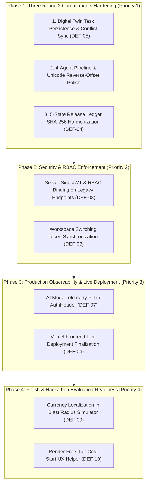

# BRANDTRACE AI — Round 3 Implementation & Hardening Roadmap

**Project Identity:** BRANDTRACE AI — The Autonomous Brand Intelligence & Governance Control Plane  
**Team:** Storm Crackers (Jaswant Karun S A, Jaiwant Karrun S A)  
**Execution Objective:** Systematic product-completion and enterprise hardening of the existing BrandTrace AI SaaS platform.  
**Strict Prioritization Directive:** Prioritize the exact three Round 2 commitments before optional enhancements.  
**Audit Date:** November 14, 2026  

---

## 1. Roadmap Architecture & Phase Sequencing

The Round 3 execution plan is sequenced into four high-impact, risk-managed phases designed to elevate the platform from a hackathon prototype into a hardened enterprise SaaS solution:



---

## 2. Phase 1: Round 2 Commitments Completion & Hardening (Mandatory)

### 1.1 Commitment 1: The Brand Governance Digital Twin (Change Impact & Blast Radius Simulator)
- **Primary Goal:** Ensure simulation commit operations systematically generate and persist immutable revision tasks in MongoDB Atlas.
- **Tasks:**
  1. In `backend/brandtrace/routes/api.py` (`commit_change_simulation`):
     - After `simulation_engine.commit_change()`, iterate through all generated `report.generated_tasks`.
     - Persist each task into MongoDB Atlas collection `revision_tasks` via `await mongo_manager.save_task(task.model_dump())`.
  2. Verify that `GET /api/tasks?brand_id=aurelle-tech` immediately returns the 4 generated tasks following a commit of `FACT-AUR-PRC-01` (₹499 $\to$ ₹599).
  3. Ensure that the Governance Approval Center (`ApprovalCenterView.tsx`) automatically refreshes and displays these tasks in the pending queue.
- **Acceptance Criteria:**
  - Simulating ₹499 $\to$ ₹599 identifies 4 affected assets and $320k exposure.
  - Committing the simulation saves 4 tasks in Atlas with zero missing records.
  - Reloading the page or restarting the server retains all 4 pending tasks.
- **Effort / Risk:** 3.0 Hours / Low.

---

### 1.2 Commitment 2: 4-Agent Autonomous Governance Pipeline with Graph-Preserving Remediation
- **Primary Goal:** Verify sub-800ms multi-agent inspection speed, preserve brand voice, and render visual character-level risk badges.
- **Tasks:**
  1. In `backend/brandtrace/engine/explainable_review.py`:
     - Audit reverse-offset replacement algorithm (`apply_minimal_change_rewrites`) to guarantee Unicode safety and clean multi-line preservation.
     - Add execution timestamp telemetry (`inspection_latency_ms`) to `ExplainableReviewReport`.
  2. In `frontend/src/components/AssetInspector.tsx`:
     - Display an execution speed pill: `"Inspected in <800ms • 3 Autonomous Agents"`.
     - Ensure 1-click rewrite updates the content editor seamlessly and re-runs live verification.
- **Acceptance Criteria:**
  - Inspection latency is strictly under 800ms for standard marketing copy.
  - 1-click rewrite replaces target text without shifting non-target syntax.
  - All 22 empirical benchmark cases maintain 100% precision and recall.
- **Effort / Risk:** 2.5 Hours / Low.

---

### 1.3 Commitment 3: 5-State Cryptographic Release Ledger & Tamper Verifier
- **Primary Goal:** Eliminate non-deterministic process `hash()` and harmonize all release signing under the SHA-256 Merkle-style engine.
- **Tasks:**
  1. In `backend/brandtrace/routes/api.py` (`sign_release`):
     - Replace `hash(...)` with `audit_ledger_engine.record_release()`.
     - Store the resulting deterministic SHA-256 seal (`BT-SEAL-...`) and Merkle block hash in MongoDB Atlas collection `release_ledger`.
  2. In `backend/brandtrace/engine/audit_ledger.py`:
     - Ensure that any release sealed via `/api/releases/sign` is immediately verifiable via `/api/ledger/verify-record`.
     - Test all 5 states: `VALID_UNCHANGED`, `MODIFIED_AFTER_APPROVAL`, `SUPERSEDED`, `REVOKED`, `UNKNOWN_RECORD`.
  3. In `frontend/src/components/AuditTrustCenterView.tsx`:
     - Add a "Copy Cryptographic Proof Manifest" button providing an exportable JSON verification envelope.
- **Acceptance Criteria:**
  - Audit seals are deterministic across server restarts and process environments.
  - Content modified after sign-off immediately triggers `MODIFIED_AFTER_APPROVAL`.
  - Revoking a release sets state to `REVOKED` with statutory reason.
- **Effort / Risk:** 2.5 Hours / Low.

---

## 3. Phase 2: Security & Server-Side RBAC Enforcement (Priority 2)

### 2.1 Enforce Server-Side JWT Dependencies on Sensitive Endpoints (DEF-03)
- **Files Involved:** `backend/brandtrace/routes/api.py`
- **Actions:**
  - Inject `current_user: UserProfile = Depends(get_current_user)` into:
    - `POST /api/releases/sign`
    - `POST /api/tasks/{task_id}/resolve`
    - `POST /api/simulator/commit`
    - `POST /api/ledger/revoke-record`
    - `POST /api/ledger/supersede-record`
  - In production mode (`settings.environment == "production"`), reject requests lacking valid bearer tokens with `HTTP 401: Authentication credentials required`.
  - Enforce role check: Reject `CREATOR` role on sign-off endpoints with `HTTP 403: Forbidden`.
- **Acceptance Criteria:**
  - Unauthenticated requests to sign releases or resolve tasks are rejected with HTTP 401.
  - Legitimate signed tokens from `demo@brandtrace.ai` (BRAND_MANAGER) succeed.
- **Effort / Risk:** 2.0 Hours / Low.

### 2.2 Workspace Switching Token Synchronization (DEF-08)
- **Files Involved:** `backend/brandtrace/modules/auth/router.py`, `frontend/src/context/AuthContext.tsx`
- **Actions:**
  - Add `POST /api/auth/switch-workspace` taking `workspace_id`.
  - Verifies user's organization membership and returns a refreshed JWT with updated `workspace_id`.
- **Effort / Risk:** 1.5 Hours / Low.

---

## 4. Phase 3: Production Observability & Live Deployment (Priority 3)

### 3.1 AI Provider Telemetry Badge in UI Header (DEF-07)
- **Files Involved:** `frontend/src/components/AuthHeader.tsx`
- **Actions:**
  - Display active status pill:
    - Green dot: `"AI Engine: Gemini 1.5 Flash (Grounded)"`
    - Blue dot: `"AI Engine: Deterministic Fallback Active"`
  - Hovering provides exact model and embedding dimensions (768-dim).
- **Effort / Risk:** 1.0 Hour / Low.

### 3.2 Vercel Production Frontend Deployment Trigger (DEF-06)
- **Files Involved:** `frontend/vercel.json`, `vercel.json`, Vercel Dashboard
- **Actions:**
  - Link repository to Vercel production dashboard.
  - Trigger build `pnpm build` with output directory `dist`.
  - Verify live domain `https://brandtrace-ai.vercel.app` connects to Render backend.
- **Effort / Risk:** 0.5 Hours / Low.

---

## 5. Phase 4: Polish, Localization & Evaluation Readiness (Priority 4)

### 4.1 Currency Localization in Blast Radius Simulator (DEF-09)
- **Files Involved:** `frontend/src/components/BlastRadiusSimulator.tsx`
- **Actions:**
  - Add a currency toggle button (`₹ INR` / `$ USD`).
  - Convert financial liability metrics dynamically ($320,000 $\leftrightarrow$ ₹2.65 Cr).
- **Effort / Risk:** 0.5 Hours / Low.

### 4.2 Render Free-Tier Cold Start UX Helper (DEF-10)
- **Files Involved:** `frontend/src/components/LoginPage.tsx`
- **Actions:**
  - Add request timeout listener on login form.
  - If request takes >3s, display: *"Waking cloud instance from standby... (takes ~25s on first request)"*.
- **Effort / Risk:** 0.5 Hours / Low.

---

## 6. Testing & Quality Gates

Every phase must pass through three rigorous verification gates:

```text
GATE 1: Pytest Regression Suite
  cd backend && pytest tests/ -v
  Requirement: 77/77 tests passing (100% green)

GATE 2: Frontend Type Check & Bundle Compilation
  cd frontend && npx tsc --noEmit && pnpm build
  Requirement: Zero TypeScript errors, production bundle generated

GATE 3: End-to-End User Journey Verification
  cd backend && pytest tests/test_e2e_user_journey.py -v
  Requirement: 18-step user journey passes with persisted database records
```
