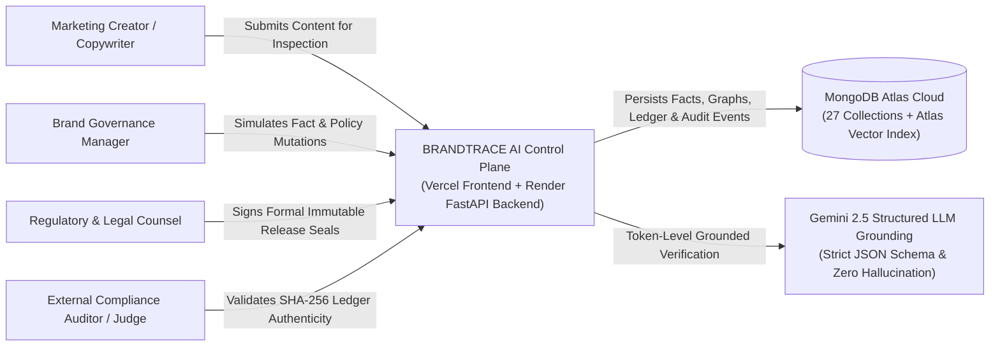
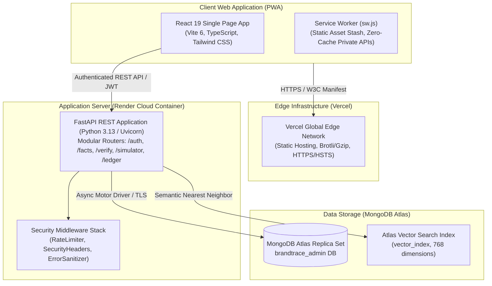
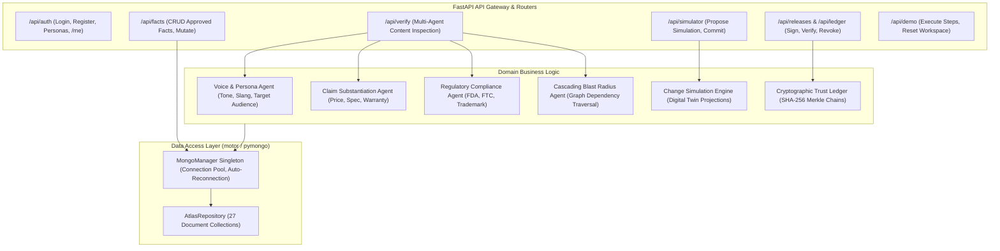
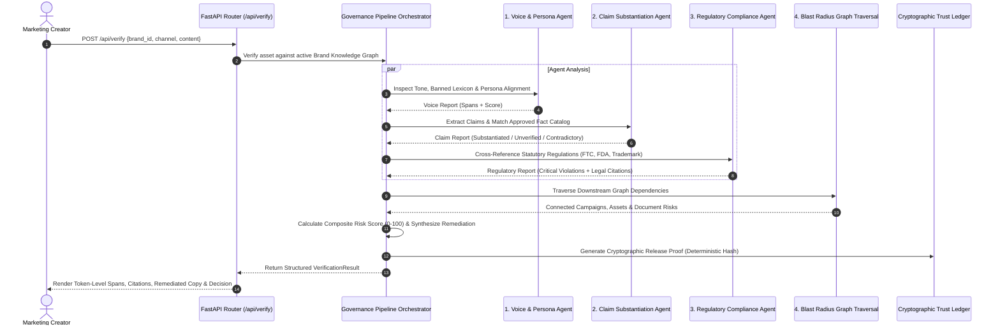
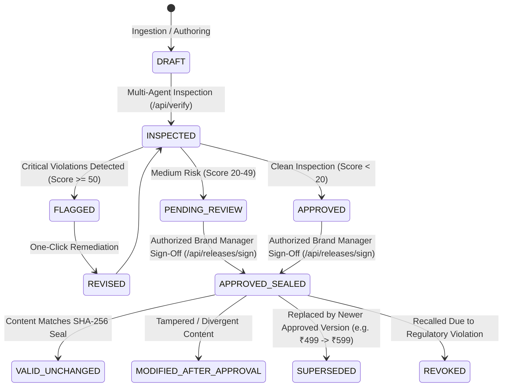

# BRANDTRACE AI — Enterprise System Architecture 🏛️

> **The Autonomous Brand Intelligence & Governance Control Plane**  
> *Every brand decision connected. Every risk traceable. Every release accountable.*

---

## 1. Executive Architectural Overview

BRANDTRACE AI is an autonomous enterprise brand intelligence and governance control plane. It unifies marketing operations, compliance teams, legal counsel, and creative directors into a single connected workspace.

Instead of evaluating marketing and commercial copy as disconnected text fragments, BRANDTRACE AI connects every marketing asset, campaign, document, and claim to an immutable truth-set: the **Brand Dependency Intelligence Graph (BDIG)**.

```mermaid
flowchart TB
    subgraph PresentationLayer ["1. Presentation Layer (React 19 + TypeScript + Vite + PWA)"]
        UI_Nav["Responsive App Shell & Navigation (Desktop / Tablet / Mobile Drawer)"]
        UI_CC["Executive Command Center (Real-Time Governance Telemetry)"]
        UI_Canvas["Interactive BDIG Canvas (@xyflow/react Directed Graph)"]
        UI_Sim["Governance Digital Twin (Change Impact Simulator)"]
        UI_Inspect["Multi-Agent Content Inspector & Multimodal Studio"]
        UI_Trust["Cryptographic Trust & Audit Center (5-State Ledger Verifier)"]
        UI_PWA["Zero-Trust Service Worker (PWA Offline Fallback Shell)"]
    end

    subgraph SecurityLayer ["2. Edge Security, Middleware & Boundary Guard"]
        RateLimit["Sliding Window Rate Limiter (120 req/min per client IP/Token)"]
        SecHeaders["Enterprise OWASP Security Headers (nosniff, DENY, XSS-block)"]
        Sanitization["Credential, URI & Stack-Trace Redactor"]
        RBAC_Guard["Strict Server-Side RBAC & Multi-Tenant Organization Boundary"]
    end

    subgraph CoreEngines ["3. Autonomous Governance & Intelligence Engines"]
        Graph_Engine["Brand Knowledge Graph Engine (NetworkX + BDIG Directed Traversal)"]
        DigitalTwin["Brand Governance Digital Twin (Policy Contradiction & Blast Radius)"]
        AgentPipeline["Autonomous Multi-Agent Orchestrator (Voice, Claims, Legal, Blast)"]
        Ledger_Engine["Cryptographic Trust Ledger (Deterministic SHA-256 Merkle Sealing)"]
    end

    subgraph PersistenceLayer ["4. Persistence & Semantic Grounding"]
        Atlas_DB[("MongoDB Atlas 7.0 Cluster (27 Enterprise BSON Collections)")]
        Atlas_Vector["MongoDB Atlas Vector Search ($vectorSearch, 768-dim Embeddings)"]
        Memory_Fallback["Pragmatic In-Memory Resilient Cache & Deterministic Mock Store"]
    end

    PresentationLayer --> SecurityLayer
    SecurityLayer --> CoreEngines
    CoreEngines --> PersistenceLayer
```

---

## 2. C4 Architecture Breakdown

### Level 1: System Context
The System Context diagram portrays how BRANDTRACE AI interfaces with external enterprise personas, marketing channels, and storage engines:

### Level 2: Container Diagram
The Container diagram highlights the deployed execution environments:

### Level 3: Component Diagram (FastAPI Backend Control Plane)

---

## 3. Autonomous Multi-Agent Reasoning Pipeline

The inspection pipeline evaluates content against 4 specialized autonomous agents executing sequentially or in parallel:

### Agent Roles & Governance Responsibilities:
1. **Voice & Brand Persona Agent:**
   - Detects deviations from defined tonal attributes (e.g., authoritative, elevated, accessible).
   - Identifies prohibited informalities, excessive hyperbole, or unauthorized slang.
   - Evaluates channel-specific constraints (Instagram ads vs. Investor presentations).
2. **Claim Substantiation Agent:**
   - Performs named entity and numeric extraction on pricing, battery specs, speed claims, and guarantees.
   - Grounded strictly against the MongoDB-backed Approved Facts Catalog (`APPROVED_FACTS_CATALOG`).
   - Flags unverified assertions with clear citation gaps.
3. **Regulatory & Legal Compliance Agent:**
   - Scans for statutory non-compliance: medical diagnosis claims without FDA clearance (21 CFR §870), unsubstantiated environmental guarantees (FTC Green Guides), or uncredited trademark marks (™ / ®).
   - Assigns severity ratings: `CRITICAL`, `HIGH`, `MEDIUM`, or `LOW`.
4. **Cascading Blast Radius Agent:**
   - Traverses the NetworkX directed acyclic graph to identify upstream dependencies and downstream exposure.
   - Computes organizational ripple effects across active campaigns and public channels.

---

## 4. Brand Dependency Intelligence Graph (BDIG)

The BDIG is modeled as an in-memory NetworkX directed graph backed by MongoDB Atlas collections (`graph_nodes`, `graph_relationships`, `knowledge_nodes`).

### Node Types:
- `GUIDELINE`: Brand rules, tone policies, regulatory mandates, and design constraints.
- `FACT`: Verified pricing, hardware specifications, battery life metrics, warranty terms.
- `CLAIM`: Approved marketing assertions grounded in substantiated evidence.
- `CAMPAIGN`: Active commercial flights (e.g., "Aurelle Spatial Audio Q1 Launch").
- `ASSET`: Published or pending marketing touchpoints (Instagram feed ads, landing pages, packaging).
- `DOCUMENT`: Legal disclaimers, FDA filings, technical whitepapers, SLA agreements.

### Edge Types:
- `GOVERNED_BY`: Content asset governed by a specific brand guideline or policy.
- `SUBSTANTIATED_BY`: Claim or copy substantiated by an approved fact or source document.
- `PART_OF_CAMPAIGN`: Asset belonging to an omnichannel campaign flight.
- `DEPENDS_ON`: Commercial dependency between two brand parameters.
- `SUPERSEDES`: Version lineage connecting current approved facts with historical precedents.

---

## 5. Cryptographic Release Ledger & 5-State Architecture

Every approved release is sealed with a deterministic SHA-256 cryptographic signature that chains the asset identifier, canonical content string, approving reviewer identity, and timestamp into an immutable tamper-evident seal.

### 5 Statutory Release States:
1. `VALID_UNCHANGED`: Content perfectly matches the cryptographic seal generated at the time of human sign-off.
2. `MODIFIED_AFTER_APPROVAL`: Content has drifted or been maliciously edited after authorized approval. Tampering is flagged instantly.
3. `SUPERSEDED`: Content was legally approved for a prior version, but has been legitimately superseded by a newer approved master record (e.g., historical ₹499 pricing replaced by ₹599 master).
4. `REVOKED`: The release seal has been explicitly invalidated due to an active product recall or regulatory decree.
5. `UNKNOWN_RECORD`: Content hash does not exist in either active memory or MongoDB Atlas release ledger archives.

---

## 6. Resilience, Security & Multi-Tenant Isolation

1. **Sliding-Window Rate Limiter:** 
   - Protects backend APIs from denial-of-service bursts (120 req/minute per IP/token).
   - Test suites and internal services utilize elevated limits (`X-Test-Rate-Limit`).
2. **Server-Side RBAC Enforcement:**
   - 5 organizational personas: `ADMIN`, `BRAND_MANAGER`, `COMPLIANCE_REVIEWER`, `REVIEWER`, `CREATOR`.
   - Critical mutation endpoints (`/api/simulator/commit`, `/api/facts/mutate`, `/api/demo/reset`) enforce role boundaries strictly on the server.
3. **Data Redaction & Error Sanitization:**
   - Custom `ErrorSanitizationMiddleware` scrubs database URIs, API tokens, and internal stack traces before HTTP responses leave the server perimeter.
4. **Tenant Isolation:**
   - Multi-tenant architecture logically partitions all records by `organisation_id` (`ORG-AURELLE`, `ORG-APEX`) and `workspace_id`.
   - Cross-tenant lookups and mutations are blocked at the repository layer.
5. **Progressive Web App (PWA) Zero-Trust Caching:**
   - Service worker caches only immutable static assets (HTML, CSS, JS, SVG).
   - API endpoints (`/api/*`), authentication credentials, and customer data are explicitly excluded from browser storage caches to prevent stale compliance states.
