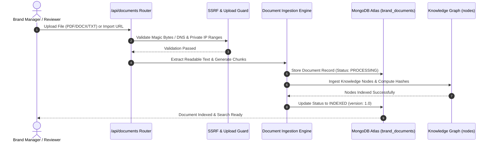
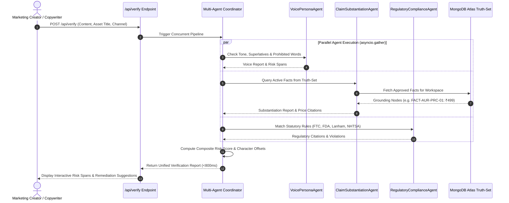
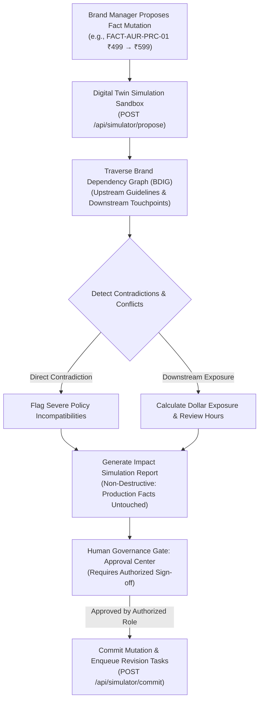
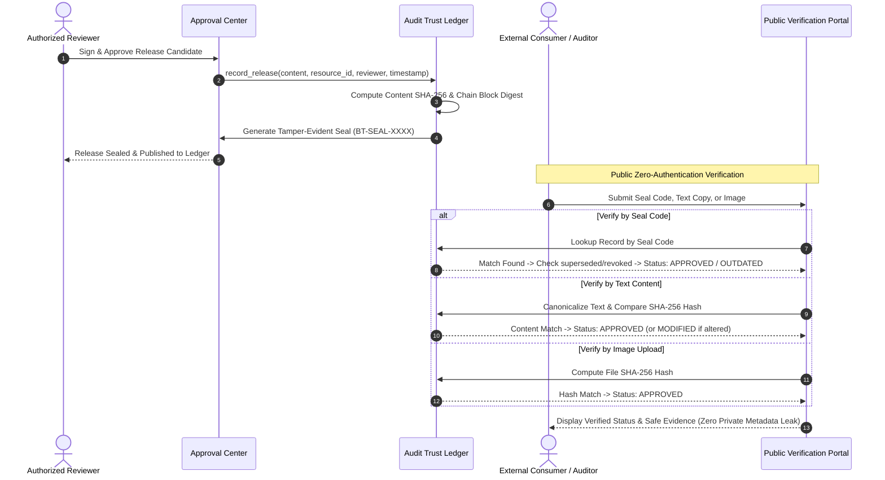

# BRANDTRACE AI — Enterprise System Architecture 🏛️

> **The Autonomous Brand Intelligence & Governance Control Plane**  
> *Tagline: Detect. Predict. Verify. Prevent.*

---

## 1. Architectural Overview & Design Principles

**BrandTrace AI** is engineered as a zero-trust, human-in-the-loop autonomous governance control plane. It bridges the gap between approved brand truth-sets (guidelines, pricing, product specifications, claims) and multi-channel creative publication.

### Core Architectural Principles:
1. **Grounded Graph Truth-Set (BDIG):** Marketing copy and commercial claims are never evaluated in a vacuum; they are grounded in the **Brand Dependency Intelligence Graph (BDIG)**.
2. **Concurrent Multi-Agent Reasoning (<800ms SLA):** Specialized agents execute in parallel using asynchronous concurrency (`asyncio.gather`), returning explainable evidence and exact character spans without causing creative bottlenecks.
3. **Predictive Digital Twin Sandbox:** Changes to brand facts are simulated in a virtual sandbox before altering production records, quantifying blast radius and financial risk exposure upfront.
4. **Strict Human Gate:** Zero autonomous publishing. All releases, guideline updates, and fact mutations require explicit human review and cryptographic authorization.
5. **Tamper-Evident Ledger Provenance:** Releases receive internal SHA-256 chained block digest seals, verifiable by consumers worldwide without corporate sign-in.
6. **Strict Multi-Tenant Isolation:** Enforces `org_id` and `workspace_id` boundaries across all database queries, document indexing, and agent pipelines.

---

## 2. End-to-End System Architecture

```mermaid
flowchart TB
    subgraph ClientLayer ["1. Presentation Layer (React 19 + TypeScript + Vite + Tailwind CSS)"]
        UI_Nav["Responsive App Shell (Desktop / Tablet / Mobile Drawer)"]
        UI_Doc["Brand Knowledge Studio (Document Management, File Upload, SSRF Import)"]
        UI_BDIG["Brand Dependency Graph (@xyflow/react Directed Canvas)"]
        UI_Sim["Brand Governance Digital Twin (Blast Radius &amp; Risk Simulator)"]
        UI_Agents["Multi-Agent Content Intelligence &amp; Inspection Studio"]
        UI_Approvals["Human Governance Approval Center (Atomic Review Queue)"]
        UI_Public["Public Verification Portal (Zero-Auth Seal / Text / Image Verifier)"]
    end

    subgraph SecurityLayer ["2. Edge Security, Middleware &amp; Boundary Guard"]
        RateLimit["Rate Limiter (120 req/min auth, 60 req/min public)"]
        SecHeaders["OWASP Security Headers (nosniff, DENY, strict-origin, XSS-block)"]
        TenantGuard["Strict Multi-Tenant Boundary Guard (org_id &amp; workspace_id)"]
        SSRFGuard["SSRF Defense Engine (Private IP &amp; DNS resolution validator)"]
        ErrorSanitizer["Error Sanitization &amp; Information Leakage Redactor"]
    end

    subgraph CoreEngines ["3. Autonomous Governance &amp; Intelligence Engines"]
        DocIngest["Document Ingestion Engine (PDF, DOCX, TXT, MD Extraction)"]
        AgentCoord["Concurrent Multi-Agent Coordinator (asyncio.gather)"]
        VoiceAgent["VoicePersonaAgent (Tone, Superlatives, Style)"]
        ClaimAgent["ClaimSubstantiationAgent (Fact Grounding)"]
        RegAgent["RegulatoryComplianceAgent (FTC, FDA, Lanham, NHTSA)"]
        DigitalTwin["Digital Twin Blast Radius Engine (NetworkX Graph)"]
        LedgerEngine["Audit Trust Ledger (SHA-256 Merkle-Style Chained Blocks)"]
    end

    subgraph PersistenceLayer ["4. Persistence &amp; Grounding Layer"]
        Atlas_DB[("MongoDB Atlas 7.0 Cluster (Motor Async Driver)")]
        Atlas_Vector["Atlas Vector Search (768-dim Embeddings with Lexical Fallback)"]
        Memory_Fallback["Resilient In-Memory Repository Fallback"]
    end

    ClientLayer --> SecurityLayer
    SecurityLayer --> CoreEngines
    AgentCoord --> VoiceAgent
    AgentCoord --> ClaimAgent
    AgentCoord --> RegAgent
    CoreEngines --> PersistenceLayer
```

---

## 3. Specialized Workflows & Data Flows

### A. Document Indexing & Ingestion Flow

1. **Upload & Ingestion:** Uploads support PDF, DOCX, TXT, and Markdown. The service verifies file signatures (magic bytes) to prevent executable file masking.
2. **SSRF Defense:** URL imports pass through `validate_url_safe()`, which resolves hostnames and strictly blocks private, loopback, and link-local IP spaces (`127.0.0.1`, `10.0.0.0/8`, `172.16.0.0/12`, `192.168.0.0/16`, `169.254.169.254`).
3. **Status Progression:** Status advances honestly through `UPLOADED` &rarr; `PROCESSING` &rarr; `INDEXED`. If extraction fails, the status updates to `FAILED` with sanitized error details.
4. **Immutable Versioning:** Modifying an indexed document archives previous versions in `document_versions` and creates incremented versions (e.g. `1.1`), ensuring full historical traceability.

---

### B. Concurrent Multi-Agent Content Intelligence Pipeline

- **Monotonic Latency Target:** Strict <800ms SLA enforced across concurrent agents.
- **Explainable Evidence:** Violations return exact character offsets (`[start, end]`) for non-destructive visual highlighting, alongside direct statutory legal citations:
  - **FTC 16 CFR §260.4:** Unsubstantiated environmental / green claims.
  - **FDA 21 CFR §202.1 & §870:** Medical diagnostic cures vs. general wellness device claims.
  - **Lanham Act §43(a):** Trademark symbol omission and comparative deception.
  - **NHTSA SGO 2021-01:** False autonomous self-driving safety assertions.

---

### C. Brand Governance Digital Twin (Change Impact Simulation)

1. **Virtual Sandbox:** Changes are simulated without modifying production facts in MongoDB Atlas.
2. **Blast Radius Computation:** Traverses the BDIG graph to identify all dependent campaigns, ad copies, packaging designs, and partner touchpoints.
3. **Quantified Exposure:** Projects financial risk exposure (e.g., $320,000 for Aurelle price mutation) and calculates required departmental review workload (e.g., 12.5 hours).
4. **Human Commit Gate:** Commits require explicit authorization by a user with `ADMIN` or `COMPLIANCE_REVIEWER` privileges.

---

### D. Cryptographic Release Ledger & Public Verification Flow

1. **SHA-256 Tamper-Evident Digest Chaining:**
   $$\text{Block Material} = \text{rec\_id} \parallel \text{last\_block\_hash} \parallel \text{resource\_id} \parallel \text{content\_hash} \parallel \text{user\_identity} \parallel \text{timestamp}$$
   $$\text{Seal Code} = \text{BT-SEAL-} \parallel \text{SHA-256}(\text{Block Material})[:16].\text{upper()}$$
2. **Zero-Auth Verification:** External consumers verify published marketing assets without creating accounts or passing corporate credentials.
3. **Canonical Text Normalization:** Strips smart quotes (`“`, `”`, `‘`, `’`, `"`, `'`), collapses redundant whitespace and newlines, while preserving numbers and case to ensure formatting variations do not cause false modification alarms.
4. **Privacy Shield:** Public verification responses strictly exclude reviewer email addresses, internal user IDs, employee roles, and MongoDB `_id` identifiers.

---

## 4. Database Design & Multi-Tenant Model

BrandTrace AI is backed by a structured MongoDB Atlas cluster with **27 enterprise BSON collections**:

| Domain | Collections | Tenant Isolation Key |
| :--- | :--- | :--- |
| **Organizations & Users** | `organizations`, `users`, `workspace_memberships`, `roles_permissions` | `org_id` |
| **Brand Knowledge Base** | `brand_documents`, `document_versions`, `knowledge_nodes`, `approved_facts`, `brand_guidelines`, `terminology`, `fact_sources` | `org_id`, `workspace_id` |
| **Graph Intelligence** | `graph_nodes`, `graph_relationships` | `workspace_id` |
| **Content & Multi-Agent** | `content_assets`, `content_versions`, `verifications`, `suggested_corrections`, `evidence_references` | `org_id`, `workspace_id` |
| **Simulation & Digital Twin** | `change_simulations`, `impact_reports` | `workspace_id` |
| **Approvals & Governance** | `approval_decisions`, `review_assignments`, `revision_tasks`, `comments` | `org_id`, `workspace_id` |
| **Audit & Cryptographic Ledger** | `release_ledger`, `audit_events`, `notifications` | `org_id`, `workspace_id` |

### Multi-Tenant Boundary Enforcement:
- Every query to `brand_documents`, `knowledge_nodes`, `verifications`, and `release_ledger` scopes automatically by the authenticated user's `org_id` and `workspace_id`.
- Cross-tenant access attempts return HTTP 404 (preventing cross-tenant entity enumeration).
