# BRANDTRACE AI — Enterprise System Architecture 🏛️

> **The Autonomous Brand Intelligence & Governance Control Plane**  
> *Every brand decision connected. Every risk traceable. Every release accountable.*

---

## 1. System Architecture Overview

BRANDTRACE AI is engineered as a decoupled, multi-tenant enterprise governance control plane. It bridges brand decision-makers (Legal, Brand, Marketing) and technical publishing channels through a centralized **Brand Dependency Intelligence Graph (BDIG)**.

```mermaid
flowchart TB
    subgraph PresentationLayer ["1. Presentation Layer (React 19 + TypeScript)"]
        UI_Nav["Modular Sidebar (14 Business Domains)"]
        UI_CC["Executive Command Center (Telemetry)"]
        UI_Canvas["Interactive BDIG Canvas (@xyflow/react)"]
        UI_Sim["Governance Digital Twin (Blast Radius)"]
        UI_Inspect["Multimodal Asset Inspector (AST/Text/Vision)"]
        UI_Trust["Audit & Trust Center (5-State Verifier)"]
    end

    subgraph SecurityLayer ["2. Security, Rate Limiting & Routing Layer"]
        RateLimit["Sliding Window Rate Limiter (120 req/min)"]
        SecHeaders["Enterprise Security Headers (OWASP)"]
        Sanitization["Credential & Stack Trace Redactor"]
        RBAC_Guard["Server-Side RBAC & Multi-Tenant Boundary Guard"]
    end

    subgraph CoreEngines ["3. Core Governance & Intelligence Engines"]
        Graph_Engine["Brand Knowledge Graph Engine (NetworkX + Traversal)"]
        DigitalTwin["Brand Governance Digital Twin (Policy Conflict & Workload)"]
        AgentPipeline["Multi-Agent Inspection Orchestrator (Voice, Claims, Regs)"]
        Ledger_Engine["Cryptographic Trust Ledger (SHA-256 Merkle Sealing)"]
    end

    subgraph PersistenceLayer ["4. Primary Database & Semantic Storage"]
        Atlas_DB[("MongoDB Atlas 7.0 (27 BSON Collections)")]
        Atlas_Vector["MongoDB Atlas Vector Search ($vectorSearch, 768-dim)"]
        Memory_Fallback["Resilient Offline In-Memory Fallback"]
    end

    PresentationLayer --> SecurityLayer
    SecurityLayer --> CoreEngines
    CoreEngines --> PersistenceLayer
```

---

## 2. Frontend Architecture

- **Framework:** React 19 with TypeScript, bundled with Vite 6.
- **Styling & Design System:** Tailwind CSS with custom editorial SaaS palette:
  - Base Foundations: Deep Navy (`#070B14`, `#0B0F19`) and Slate-950 (`#020617`).
  - Active Accents: Electric Cyan (`#06B6D4`), Royal Blue (`#2563EB`), Emerald (`#10B981`), Rose (`#F43F5E`).
- **Graph Visualization:** `@xyflow/react` (React Flow) rendering custom nodes (`BrandNode.tsx`) with animated bezier dependency edges, real-time traversal glow effects, and severity pulses.
- **State Management & Transitions:** Framer Motion powering tab transitions, modal overlays, and collapsible sidebar states.
- **API Communication:** Centralized singleton `apiClient.ts` with error normalization, JWT injection, tenant header propagation, and offline resilience.

---

## 3. Backend Architecture

- **Framework:** FastAPI (Python 3.13) organized by modular business domains:
  - `brandtrace/modules/auth`: JWT authentication (HS256) with constant-time password verification.
  - `brandtrace/modules/organizations`: Multi-tenant organization and brand workspace isolation.
  - `brandtrace/modules/knowledge_base`: MongoDB Atlas vector embeddings and `$vectorSearch` query dispatch.
  - `brandtrace/modules/graph_intelligence`: Live dependency graph traversal and evidence pathfinding.
  - `brandtrace/modules/content`: Content asset ingestion, AST extraction, and upload validation.
  - `brandtrace/modules/approvals`: Atomic human review assignments, sign-offs, and version commits.
  - `brandtrace/modules/demo`: Fictional enterprise AURELLE 12-step lifecycle mutation engine.
  - `brandtrace/modules/security`: Security posture telemetry, threat mitigations, and benchmark execution.
- **Middleware Pipeline:**
  - `RateLimitMiddleware`: Sliding token-bucket rate limiter (120 req/min per IP/Client-ID).
  - `SecurityHeadersMiddleware`: Enforces `X-Content-Type-Options: nosniff`, `X-Frame-Options: DENY`, `Strict-Transport-Security`, and CSP.
  - `ErrorSanitizationMiddleware`: Masks database credentials, JWT secrets, and AI API keys before error responses leave the perimeter.

---

## 4. Multi-Agent Reasoning Pipeline

When marketing content is inspected, it passes through four specialized autonomous agents:

1. **Brand Voice & Tone Agent:**
   - Evaluates linguistic tone, formality, acoustic mood, and anti-persona violations.
   - Computes cosine similarity between token embeddings and brand tone profiles.
2. **Claim & Fact Substantiation Agent:**
   - Detects quantitative empirical claims (prices, percentages, durability ratings).
   - Resolves claims against MongoDB Atlas `approved_facts` and `fact_sources`.
   - Identifies expired facts and unverified claims.
3. **Regulatory & Compliance Agent:**
   - Flags greenwashing, unfair or deceptive practices (FTC §5), Lanham Act trademark misuse, and missing statutory testing disclaimers (e.g. IEC 62133 battery disclosures).
4. **Cascading Blast Radius Agent:**
   - Traverses the Brand Knowledge Graph to identify downstream touchpoints exposed to risk.

---

## 5. Brand Dependency Intelligence Graph (BDIG)

The BDIG represents brand governance as an active directed acyclic graph (DAG):

- **Node Types:** `BRAND_GUIDELINE`, `APPROVED_FACT`, `APPROVED_CLAIM`, `TRADEMARK`, `CAMPAIGN`, `CONTENT_ASSET`, `IMAGE_ASSET`, `DOCUMENT`.
- **Edge Relationships:** `DEPENDS_ON`, `CITES_FACT`, `GOVERNED_BY`, `PART_OF_CAMPAIGN`, `SUPERSEDES`, `DERIVED_FROM`.
- **Traversal Engine:** Implements depth-bounded breadth-first search (BFS) with cycle detection, returning upstream sources, downstream affected touchpoints, campaign exposure, and cited evidence references.

---

## 6. Cryptographic Trust Ledger

Every approved release is sealed with a deterministic SHA-256 Merkle-style block header:

$$\text{Block Hash} = \text{SHA-256}(\text{Content} \parallel \text{Reviewer ID} \parallel \text{Timestamp} \parallel \text{Previous Block Hash})$$

The ledger provides real-time verification across 5 statutory states:
1. `VALID_UNCHANGED`: Content matches the cryptographic seal exactly.
2. `MODIFIED_AFTER_APPROVAL`: Content has been tampered with or altered post-approval.
3. `SUPERSEDED`: Content was approved historically but has been replaced by an authorized newer version.
4. `REVOKED`: Content approval has been explicitly rescinded by legal or compliance.
5. `UNKNOWN_RECORD`: Content hash has no registered signature in the trust ledger.
