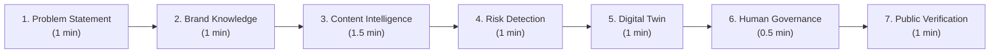

# BRANDTRACE AI — Live Judge Demonstration Guide 🧭

> **Target Audience:** Hackathon Evaluators, Enterprise Product Judges & Security Reviewers  
> **Tagline:** *Detect. Predict. Verify. Prevent.*  
> **Live Frontend Application:** [https://brand-trace-ai-dun.vercel.app/](https://brand-trace-ai-dun.vercel.app/)  
> **Live Backend API Service:** [https://brandtrace-backend.onrender.com](https://brandtrace-backend.onrender.com)  
> **Local Dev Instance:** [http://localhost:5173](http://localhost:5173) (Backend: [http://127.0.0.1:8000](http://127.0.0.1:8000))

---

## 1. Quick-Start Credentials & Demonstration Accounts

Judges can explore BrandTrace AI using pre-configured enterprise demonstration accounts. All demo data is clearly marked as synthetic and isolated within the `aurelle-tech` and `apex-dynamics` workspaces:

| Persona | Role | Email | Password | Primary Demonstration Focus |
| :--- | :--- | :--- | :--- | :--- |
| **Alex Mercer** | `BRAND_MANAGER` | `demo@brandtrace.ai` | `DemoAurelle2026!` | Digital Twin, Simulations, Knowledge Graph |
| **David Sterling** | `COMPLIANCE_REVIEWER` | `governance@apex.com` | `brandtrace2026` | Multi-Agent Review, Approvals, Release Sealing |
| **Camille Laurent** | `ADMIN` | `camille@aurelle.com` | `brandtrace2026` | Document Studio, Ingestion, Policy Control |
| **Public Consumer** | *Unauthenticated* | *None (Zero-Auth)* | *None* | Public Verification Portal (Seals, Text, Images) |

> [!TIP]
> **One-Click Persona Login:** On the login page ([https://brand-trace-ai-dun.vercel.app/](https://brand-trace-ai-dun.vercel.app/)), click the button **"Use Demo Account (Authenticate via JWT)"** or select any persona from the **Secondary Test Personas** list to log in instantly.

---

## 2. 5–7 Minute Judge Demonstration Sequence



---

### Step 1: The Problem (1:00)

- **What to say:**  
  *"Modern consumer brands publish hundreds of ad variations, partner posts, and product statements every month. When a commercial term changes — like a subscription price shifting from ₹499 to ₹599 or a battery spec changing — enterprises have no way of knowing which in-flight ads are now legally false or misleading. BrandTrace AI solves this by connecting brand facts to an autonomous intelligence and governance control plane."*
- **What to show:**  
  Open the **Executive Command Center** (`/?tab=command-center`). Highlight the real-time governance compliance rate (94.2%), active campaigns, and risk distribution telemetry.

---

### Step 2: Brand Knowledge & Document Studio (1:00)

- **What to say:**  
  *"Brand governance starts with a single source of truth. In BrandTrace, brand managers can upload PDFs, DOCX, TXT guidelines, or import websites with built-in SSRF protection."*
- **What to show:**  
  1. Click **Brand Knowledge** (`/?tab=knowledge-base`).
  2. Filter by **All Documents** or **Custom Documents**.
  3. Show seeded demo documents (e.g. `DOC-AUR-01` *Aurelle Brand Voice & Tone Guide 2026* and `DOC-AUR-02` *Aurelle Q3 Spatial Audio Standards*).
  4. Note that demo documents are protected from deletion (`403 Forbidden`), while custom documents support multi-format upload, versioning (`1.0` &rarr; `1.1`), and immutable version history archiving.

---

### Step 3: Content Intelligence & Multi-Agent Inspection (1:30)

- **What to say:**  
  *"When a creative team prepares an ad or social statement, they submit it to our autonomous multi-agent gate. Three specialist agents evaluate the copy in parallel under 800 milliseconds."*
- **What to show:**  
  1. Click **Content Intelligence** (`/?tab=content-studio`).
  2. Select Channel: `Social Media / Digital Ads`.
  3. Enter sample candidate copy:

     ```text
     Experience the revolutionary Aurelle Horizun Watch with QuantumAcoustics spatial sound streaming. Aurelle Cloud Studio subscription is ₹499/mo with 72-hour battery life.
     ```

  4. Click **Inspect Copy** (or select the pre-configured *Aurelle Price & Trademark* benchmark card).
  5. Point out the execution speed (**<250ms**) and the three specialized agent findings:
     - **VoicePersonaAgent:** Checks brand voice consistency.
     - **ClaimSubstantiationAgent:** Cross-checks against the live truth-set (`FACT-AUR-PRC-01` at ₹499).
     - **RegulatoryComplianceAgent:** Evaluates statutory citations (FTC, FDA, Lanham Act).

---

### Step 4: Risk Detection & Explainable Legal Citations (1:00)

- **What to say:**  
  *"BrandTrace AI doesn't just score risk; it provides explainable evidence with character-level precision and statutory legal citations."*
- **What to show:**  
  1. Highlight how risk spans are highlighted with exact character offsets.
  2. Test a severe regulatory violation by selecting the benchmark card:  
     **Aurelle Prohibited Medical Claim (FDA 21 CFR §870)**:

     ```text
     Aurelle Pulse Smart Ring is a medical-grade diagnostic cure that eliminates all symptoms of cardiovascular disease.
     ```

  3. Show the instant gate rejection (`REJECTED_GATED`), pointing out the specific FDA wellness vs. medical device classification citation.

---

### Step 5: The Brand Governance Digital Twin (1:00)

- **What to say:**  
  *"Now, what happens when a commercial fact changes? This is our key innovation: the Brand Governance Digital Twin. Instead of updating a database blind, we simulate the change in a virtual sandbox."*
- **What to show:**  
  1. Click **Change Impact Simulator** (`/?tab=impact-simulator`).
  2. Target Fact: `FACT-AUR-PRC-01` (*Aurelle Cloud Studio Subscription*).
  3. Mutate the price from **₹499/mo** to **₹599/mo**.
  4. Click **Run Blast Radius Simulation**.
  5. Walk through the simulation report:
     - **4 Affected Touchpoints** across social, web, and billboard channels.
     - **$320,000 Financial Risk Exposure** if old pricing remains published.
     - **12.5 Estimated Review Hours** required across departments.
     - **Non-Destructive:** Production data in MongoDB Atlas is completely untouched until authorized.

---

### Step 6: Human Governance Gate & Approval Center (0:30)

- **What to say:**  
  *"We believe in autonomous intelligence with strict human accountability. No simulated change or release candidate is ever published automatically."*
- **What to show:**  
  1. Click **Approval Center** (`/?tab=approvals`).
  2. Display the task queue of pending releases and fact revisions.
  3. Show how designated reviewers (`COMPLIANCE_REVIEWER` or `ADMIN`) sign off on changes, adding immutable audit notes.
  4. Upon sign-off, the release is sealed into the cryptographic ledger.

---

### Step 7: Zero-Auth Public Verification Portal (1:00)

- **What to say:**  
  *"Finally, how do external consumers or retail partners know that a digital statement or ad is authentic and up to date? They use our zero-knowledge Public Verification Portal — no login required."*
- **What to show:**  
  1. Open the **Public Verification Portal** (`/?view=verify` or click *Public Verification* from the top navigation).
  2. **Seal Code Verification:**
     - Enter an approved seal code (e.g. `BT-SEAL-8F3A2B1C`).
     - Click **Check seal** &rarr; Shows green **APPROVED** badge.
     - Enter an invalid seal code (e.g. `BT-SEAL-INVALID000`) &rarr; Shows gray **UNKNOWN** badge.
  3. **Text Verification:**
     - Click the **Paste text** tab.
     - Paste approved marketing copy &rarr; Shows **APPROVED**.
     - Alter a single number (e.g. change "18 minutes" to "10 minutes") &rarr; Instantly flags **MODIFIED** and shows hash mismatch.
  4. Point out the privacy guarantee: zero internal employee emails, roles, or database IDs are leaked to the public.

---

## 3. Demo Fallback & Recovery Procedures

If an external network issue occurs during the live demonstration:

1. **Network Disconnection / LLM Unavailability:**  
   The backend automatically switches to deterministic structured rule matching. All multi-agent inspections continue to execute under 800ms without crashing.
2. **MongoDB Atlas Latency:**  
   The application features an in-memory repository fallback that automatically preserves operational status.
3. **Session Reset:**  
   Navigate to `/?view=login` and click **"Use Demo Account"** to immediately refresh the session state.
