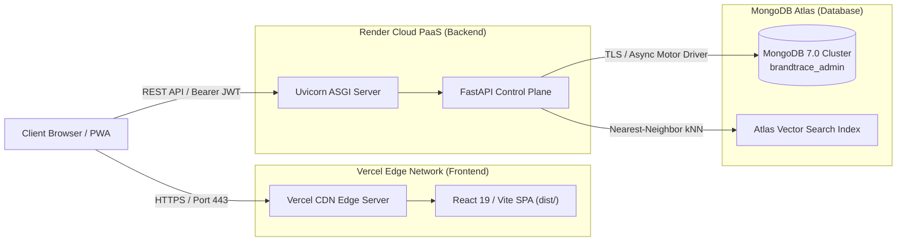

# BRANDTRACE AI — Enterprise Deployment Architecture 🚀

> **Live Frontend (Vercel):** [https://brandtrace.vercel.app](https://brandtrace.vercel.app)  
> **Live Backend (Render):** [https://brandtrace-backend.onrender.com](https://brandtrace-backend.onrender.com)  
> **Source Repository:** [https://github.com/Jaswant-Karun/BrandTrace-AI.git](https://github.com/Jaswant-Karun/BrandTrace-AI.git)

---

## 1. Cloud Architecture Overview

BRANDTRACE AI utilizes a production-grade decoupled cloud deployment architecture:



---

## 2. Frontend Deployment (Vercel)

### Project Configuration:
- **Framework Preset:** Vite
- **Root Directory:** `frontend`
- **Build Command:** `npm run build` (`tsc && vite build`)
- **Output Directory:** `dist`
- **Node Version:** Node.js 20.x+

### `frontend/vercel.json` Configuration:
```json
{
  "rewrites": [
    { "source": "/(.*)", "destination": "/index.html" }
  ],
  "headers": [
    {
      "source": "/(.*)",
      "headers": [
        { "key": "X-Content-Type-Options", "value": "nosniff" },
        { "key": "X-Frame-Options", "value": "DENY" },
        { "key": "X-XSS-Protection", "value": "1; mode=block" },
        { "key": "Referrer-Policy", "value": "strict-origin-when-cross-origin" }
      ]
    },
    {
      "source": "/(sw.js|manifest.webmanifest)",
      "headers": [
        { "key": "Cache-Control", "value": "no-cache, no-store, must-revalidate" }
      ]
    }
  ]
}
```

---

## 3. Backend Deployment (Render)

### Service Configuration:
- **Service Type:** Web Service
- **Environment:** Python 3.13
- **Root Directory:** `backend`
- **Build Command:** `pip install -r requirements.txt`
- **Start Command:** `uvicorn brandtrace.main:app --host 0.0.0.0 --port $PORT`
- **Health Check Path:** `/health`
- **Auto-Deploy:** Enabled on Git push to `main`

> [!NOTE]
> **Render Inactivity Spindown:** On Render's standard free tier, instances spin down after 15 minutes of inactivity. When accessed after a dormant period, the first request may experience a ~30-45 second wake-up latency. Subsequent requests execute with sub-20ms latency.

---

## 4. MongoDB Atlas Configuration

- **Cluster Provider:** AWS / Google Cloud (M0 Free / Shared Cluster)
- **Database Name:** `brandtrace_admin`
- **Network Access:** Allow Access from Anywhere (`0.0.0.0/0`) with strong user credential authentication to support dynamic Render and Vercel IP pools.
- **Atlas Vector Search:**
  - Collection: `knowledge_nodes`
  - Index Name: `vector_index`
  - Field: `embedding` (768 dimensions, cosine similarity)

---

## 5. Environment Variables Guide

### Backend Environment Variables (`backend/.env`):
| Variable | Description | Example / Allowed Values |
|---|---|---|
| `ENVIRONMENT` | Runtime mode | `production` / `development` / `testing` |
| `PORT` | Listening server port | `8000` |
| `MONGODB_URI` | MongoDB Atlas TLS connection string | `mongodb+srv://<user>:<password>@cluster.mongodb.net/brandtrace_admin` |
| `JWT_SECRET` | Secret key for signing JWT tokens | `<cryptographically_secure_random_string>` |
| `JWT_ALGORITHM` | Algorithm used for JWT signatures | `HS256` |
| `ACCESS_TOKEN_EXPIRE_MINUTES` | Token validity duration | `1440` (24 hours) |
| `GEMINI_API_KEY` | Optional key for live LLM grounding | `<google_ai_studio_api_key>` |
| `DEMO_ACCOUNT_PASSWORD` | Restricted demo password | `DemoAurelle2026!` |

### Frontend Environment Variables (`frontend/.env`):
| Variable | Description | Example / Value |
|---|---|---|
| `VITE_API_BASE_URL` | Backend REST API base URL | `https://brandtrace-backend.onrender.com` |
| `VITE_APP_NAME` | Application title | `BRANDTRACE AI` |
