# BRANDTRACE AI — Responsible AI & Governance Framework 🛡️

> **Core Principle:** *AI Proposes, Humans Decide, Cryptography Verifies.*

---

## 1. Ethical AI Architecture

In high-stakes enterprise brand governance, pure generative language models introduce unacceptable legal and operational risks:
- **Hallucinated Citations:** Generating fabricated FTC regulations or ASTM testing standards.
- **Silent Degradation:** Silently approving non-compliant marketing claims during LLM drift or API timeouts.
- **Loss of Agency:** Publishing marketing assets autonomously without designated human accountability.

**BRANDTRACE AI** fundamentally rejects unconstrained generative autonomy. Instead, it enforces a **Hybrid Deterministic Governance Substrate**:

```mermaid
flowchart LR
    ContentInput["Draft Marketing Asset"] --> MultiAgent["Multi-Agent Inspection"]
    MultiAgent --> DeterministicRules["Deterministic Rule & Citation Grounding"]
    DeterministicRules --> ExplainableReport["Explainable Risk Spans & Citations"]
    ExplainableReport --> HumanReview["Authorized Human Reviewer"]
    HumanReview --> CryptographicSeal["SHA-256 Release Proof Sealing"]
    CryptographicSeal --> ProductionRelease["Verified Production Release"]
```

---

## 2. Hard Limits & Non-Destructive Guardrails

### 1. Zero Autonomous Publishing
- The AI pipeline cannot publish, schedule, or push content to production.
- All high-risk and critical violations trigger `STAGED_FOR_HUMAN_REVIEW` or `REJECTED_GATED`.
- Every release proof requires a digital sign-off with an authorized reviewer persona (`ADMIN`, `BRAND_MANAGER`, or `COMPLIANCE_REVIEWER`).

### 2. Mandatory Evidentiary Citation
- The AI inspection engine is forbidden from flagging a violation or recommending a fix without attaching a valid `source_citation` linked to an active record in MongoDB Atlas.
- Uncited hallucinations fail the verification step and trigger immediate reviewer escalation.

### 3. Non-Destructive Digital Twin Simulations
- Proposed governance changes in the Change Impact Simulator are strictly demarcated with `is_simulated: true` and `simulated_status: "SIMULATED_PREVIEW_ONLY"`.
- Simulations run against isolated memory and snapshot branches; active production brand facts are never overwritten until an explicit commit endpoint is authorized.

---

## 3. Privacy, Data Protection & Multi-Tenancy

- **Complete Organization Boundary Isolation:** All queries, graph traversals, and vector searches require verified `organisation_id` headers. Cross-tenant access results in immediate HTTP 403 Forbidden exceptions and security audit logging.
- **Credential Protection:** Automatic middleware scrubbing redacts database connection strings, JWT secret keys, and AI provider API tokens from all outbound logs and API error responses.
- **Data Minimization:** No raw customer identifiable information (PII) is stored; only marketing copy, brand guidelines, and commercial claims are processed.

---

## 4. Resilience & Circuit Breaker Architecture

If the upstream AI provider (e.g. Google Gemini API) experiences latency spikes or network timeouts:
1. The system engages an internal **deterministic heuristic fallback** based on regex pattern matching, AST tree parsing, and exact brand taxonomy matching.
2. The inspection score is flagged with `circuit_breaker_active: true`, alerting reviewers that heuristic rules evaluated the copy.
3. Operations continue uninterrupted without application crashes or security compromises.
